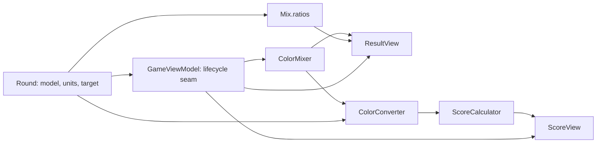
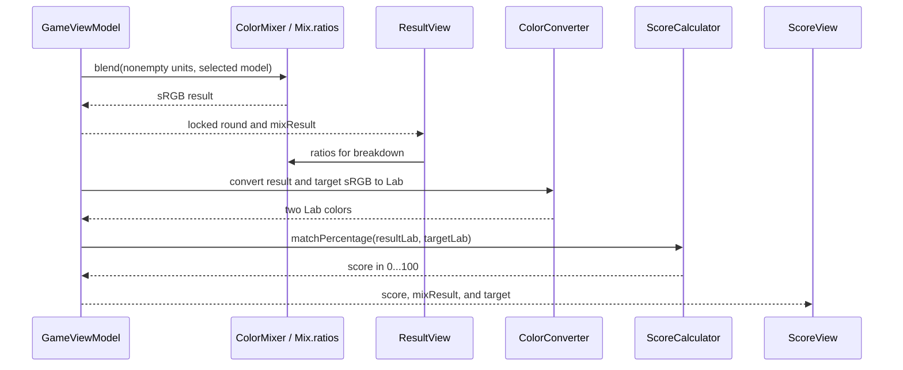

# Design Document: Color Mixing and Scoring

## Overview

This baseline describes how the existing app turns a round's contributed color units into a displayed mix, ingredient breakdown, and perceptual match score. Players use the result and score screens to discuss their choices during a single-device playtest. It introduces no new runtime behavior.

### Goals
- Preserve unit-weighted mixing in the selected palette's native component space.
- Preserve visible ingredient counts, proportions, result color, and target comparison.
- Give future rule changes a precise calculation and presentation baseline.

### Non-Goals
- Change the mixing model, score calibration, controls, phase transitions, or stored data.
- Define network synchronization, remote actions, or host/client presentation; `local-three-device-play` owns those behaviors.

## Boundary Commitments

### This Spec Owns
- The `ColorMixer.blend` output for valid CMYK and RYB units and the `Mix.ratios` calculation.
- The existing sRGB-to-Lab conversion and Delta E 2000 match calculation used by scoring.
- The ingredient breakdown, mix swatch, target comparison, and score formatting rendered by `ResultView` and `ScoreView` in single-device play.

### Out of Boundary
- `round-flow-and-input` owns single-device result-action forwarding and `GameViewModel`'s accumulation, locking, phase changes, Redo, Finish, and New Round effects; this design records the calculator calls and display inputs at that seam without redefining its lifecycle.
- `custom-color-requests` owns creation, validation, and persistence of selectable targets.
- `round-flow-and-input` owns who contributes units, when mixing occurs, and when result and score appear.
- `local-three-device-play` owns networked state exchange, role-gated controls, and pause presentation.

### Allowed Dependencies
- `Round` supplies `ColorModel`, a `Mix` of `ColorUnit` values, and the selected `ColorRequest.targetSRGB`.
- `NamedColor` supplies stable identity, name, display sRGB, and the native components for its palette.
- `ResultView` and `ScoreView` read `GameViewModel`'s `round`, `mixResult`, and `score` for presentation.
- Foundation math and SwiftUI rendering are sufficient; no package, storage schema, or new service is needed.

### Revalidation Triggers
- A change to palette components, color IDs, color model selection, or the representation of contributed units.
- A change to the sRGB/Lab conversion, Delta E 2000 implementation, score calibration or cutoff.
- A change to `GameViewModel` result/score state, action ownership, or the data supplied to the views.
- A change to result or score presentation that affects single-device and network-mode views at their shared seam.

## Architecture

### Existing Architecture Analysis

This is a baseline of existing focused helpers and SwiftUI screens. `GameViewModel.pressMixButton()` accepts only a nonempty unlocked playing mix, locks it, and stores `ColorMixer.blend` as `mixResult`. `selectFinish()` converts that result and the target to Lab and stores `ScoreCalculator.matchPercentage` as `score`. The view model retains all phase transitions. The calculation helpers do not import SwiftUI or know how the result is presented. No external dependencies, migration, or startup changes are involved.

### Architecture Pattern & Boundary Map

The existing pattern is value types for round inputs, pure helpers for math, and view-model state read by SwiftUI screens. `GameViewModel` is a shared integration seam with `round-flow-and-input`, not a new calculation owner. The network coordinator is outside this diagram and this spec.

### Technology Stack

| Layer | Existing choice | Role |
| --- | --- | --- |
| Domain | Swift 5, Foundation, SIMD values | Component blending, ratios, conversion, scoring |
| State seam | Main-actor `GameViewModel` using Observation | Stores result and score, invokes helpers |
| Presentation | SwiftUI on macOS and iOS | Result breakdown and score comparison |
| Validation | XCTest in the macOS shared scheme | Domain, flow, and rendering checks |

## File Structure Plan

All paths already exist; the baseline requires no source modifications or new files.

| Existing file | Responsibility |
| --- | --- |
| `ColorGameTesting/GameModels.swift` | `ColorModel` and `NamedColor` input contracts |
| `ColorGameTesting/ColorData.swift` | `ColorRequest` target contract and the two built-in palettes |
| `ColorGameTesting/GameState.swift` | `ColorUnit`, `Mix.ratios`, `Round`, and result/score state |
| `ColorGameTesting/ColorMixer.swift` | CMYK and RYB unit-weighted blending |
| `ColorGameTesting/ColorConverter.swift` | sRGB ↔ Lab conversion |
| `ColorGameTesting/ScoreCalculator.swift` | Delta E 2000 and calibrated match percentage |
| `ColorGameTesting/GameViewModel.swift` | Existing calculation invocation and display-value seam; phase behavior belongs to `round-flow-and-input` |
| `ColorGameTesting/Views/ResultView.swift` | Mix swatch, breakdown rows, absent-data fallback; result-action forwarding belongs to `round-flow-and-input` |
| `ColorGameTesting/Views/ScoreView.swift` | Percentage, two swatches, explanatory text, absent-data fallback |
| `ColorGameTestingTests/ColorMixerTests.swift` | Native-component weighting, identity, corner mapping, and clamping checks |
| `ColorGameTestingTests/MixRatiosTests.swift` | Nonempty ratio-sum check |
| `ColorGameTestingTests/ColorConverterTests.swift` | Color reference and conversion checks |
| `ColorGameTestingTests/ScoreCalculatorTests.swift` | Delta E reference cases and calibrated score checks |
| `ColorGameTestingTests/ResultViewTests.swift` | Breakdown order, count, rounding, and rendering checks |
| `ColorGameTestingTests/ScoreViewTests.swift` | Display rounding check |
| `ColorGameTestingTests/GameViewModelFlowTests.swift` | Mix and score invocation in the existing round lifecycle |

## System Flows

The result is calculated only after the view model accepts a nonempty playing mix. The scoring calculation occurs only when Finish is accepted from the result phase. Redo and New Round lifecycle effects remain in the round-flow specification.

## Requirements Traceability

| Requirement | Existing contract and evidence |
| --- | --- |
| 1.1 | `ColorMixer.blend` single-ID path; `ColorMixerTests.testSingleDistinctColorReturnsItsStoredSRGBExactly` |
| 1.2 | CMYK native-component mean and conversion; `ColorMixerTests` weighted and focused CMYK cases |
| 1.3 | RYB native-component mean and eight-corner conversion; `ColorMixerTests` weighted and corner cases |
| 1.4 | `ColorMixer.blend` clamps calculated channels; `testExtremeCMYKWeightAndClamping` |
| 2.1 | `Mix.ratios` counts IDs over total units; `MixRatiosTests` and `ResultViewTests` |
| 2.2 | `Mix.ratios` empty guard; `GameViewModelFlowTests.testRedoClearsMixAndResultButPreservesRequestAndCountdownThenResumes` |
| 2.3 | `ResultView.breakdown` first occurrence order, counts, one-decimal percentages; `ResultViewTests` |
| 3.1 | `ResultView` mix swatch and Grid; `ResultViewTests.testRenderedResultRespondsToSwatchAndBreakdownChanges` |
| 3.2 | `ResultView` renders `No Mix Result` when round or result is missing |
| 4.1 | `GameViewModel.selectFinish`, `ColorConverter.sRGBToLab`, `ScoreCalculator.matchPercentage`; converter, score, and flow tests |
| 4.2 | `ScoreCalculator.matchPercentage` identity endpoint; `ScoreCalculatorTests` |
| 4.3 | Delta E 2000 distance cutoff at 100; `ScoreCalculatorTests.testMatchPercentageUsesNonlinearPerceptualScore` |
| 4.4 | `ScoreView` percent format at two decimals and explanatory text; `ScoreViewTests` |
| 4.5 | `ScoreView` mix/target swatches from result and request target |
| 4.6 | `ScoreView` renders `No Score` when score is missing |

## Components and Interfaces

| Component | Boundary and contract | Requirements |
| --- | --- | --- |
| `Mix.ratios` | `Mix.units: [ColorUnit]` → `[UUID: Double]` | 2.1, 2.2, 2.3 |
| `ColorMixer` | `blend(_ units: [ColorUnit], model: ColorModel) -> SIMD3<Double>` | 1.1, 1.2, 1.3, 1.4 |
| `ColorConverter` | `sRGBToLab(_ srgb: SIMD3<Double>) -> SIMD3<Double>` | 4.1 |
| `ScoreCalculator` | `deltaE2000(_:_:)` and `matchPercentage(_:_:)` on Lab colors | 4.1, 4.2, 4.3 |
| `ResultView` | Reads `round` and `mixResult`; renders result or fallback | 2.3, 3.1, 3.2 |
| `ScoreView` | Reads `score`, optional `round` and `mixResult`; renders score or fallback | 4.4, 4.5, 4.6 |
| `GameViewModel` | Existing call seam from round lifecycle to math and screen state | 4.1 |

### Calculation contracts

- `Mix.ratios` groups units by `NamedColor.id`. For a nonempty mix, each value equals the ID's count divided by the number of units and all values sum to 1 within floating-point precision. For an empty mix, it returns an empty dictionary.
- `ColorMixer.blend` returns `(0, 0, 0)` for an empty input as a helper fallback; the normal `pressMixButton()` path rejects empty mixes. If every unit has the same color ID, it returns that color's stored sRGB unchanged. Otherwise it averages each unit's native CMYK or RYB vector. CMYK uses `(1-C)(1-K)`, `(1-M)(1-K)`, `(1-Y)(1-K)`; RYB uses a fixed eight-corner trilinear mapping, with an equal-component neutral shortcut. The calculated result is clamped per sRGB channel to `[0, 1]`. Valid callers supply components matching the selected model; absent native components cause a precondition failure rather than a fallback color.
- `ColorConverter.sRGBToLab` uses standard sRGB transfer, a fixed RGB-to-XYZ matrix, and D65 reference white. `GameViewModel.selectFinish()` converts both result and target before scoring. The reverse `labToSRGB` helper exists but is not used by this score flow.
- `ScoreCalculator.deltaE2000` returns perceptual Lab distance. `matchPercentage` caps distance at 100, maps it through `1 / (1 + distance / 200 + (distance / 23)^4)`, and normalizes the endpoints to exactly 100 at distance zero and 0 at distance 100 or greater. The percentage expresses a game-calibrated similarity, not physical pigment behavior.

### Presentation contracts

- `ResultView.breakdown(for:)` preserves first-contribution order and reports `NamedColor`, percentage, and exact count per ID. It rounds each displayed proportion separately to one decimal; displayed percentages can therefore differ slightly from a total of 100. The view shows a color swatch with an accessibility label containing rounded RGB channel percentages, a Grid with Color/Percentage/Units headers, and combined labels for each row.
- `ScoreView` formats `score / 100` as a percentage with two decimal places, states that higher percentages mean a closer match, and places the mix swatch beside the target swatch when both colors are available. A missing score shows `No Score`; a missing round or mix result omits only the swatch comparison.
- `round-flow-and-input` owns single-device result-action forwarding; optional coordinator behavior belongs to `local-three-device-play`.

## Error Handling

- The normal flow prevents empty-mix calculation and phase-inappropriate scoring through `GameViewModel` guards. Helper-level empty input has the documented zero-vector fallback.
- Result and score views show their `ContentUnavailableView` messages if required state is absent.
- Palette data must provide the native components expected by the selected model. This is a trusted in-app invariant, enforced by a precondition in `ColorMixer`.

## Testing Strategy

Existing test files contain checks for the baseline without new tasks: `ColorMixerTests` covers both model means, identity, RYB corners, and clamping; `MixRatiosTests` and `ResultViewTests` cover proportions and one-decimal rows; `ColorConverterTests` and `ScoreCalculatorTests` cover conversion, Delta E reference pairs, score endpoints and bounds; `GameViewModelFlowTests` covers the result/score integration; `ScoreViewTests` covers two-decimal formatting. Static inspection confirms the no-result/no-score fallbacks and swatch comparison. This spec run did not verify a passing Xcode test execution. Future implementation changes should rerun these focused tests and the macOS shared-scheme suite.

## Baseline Discovery and Decisions

Light, integration-focused discovery used the current working tree, including its uncommitted `ColorMixer.swift` and `ColorMixerTests.swift` changes, as the source of truth. The design retains the existing helper/view split and adds no dependency or abstraction. No behavior gap was verified from the code and tests inspected. The current baseline is sensitive to later edits to the uncommitted mixer work; those edits require revalidation before treating this spec as a fixed comparison point.
