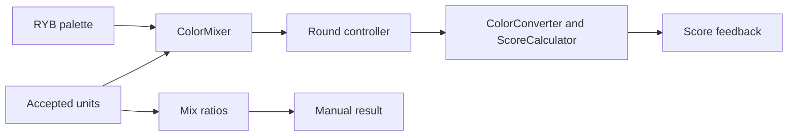

# Design Document: Color Mixing and Scoring

## Overview

Playtesting Part II retains the current calibrated RYB calculation and perceptual score while removing CMYK. Manual results and the live Auto bowl use the same calculation. The round controller supplies accepted units and determines when to expose a live color, freeze a result, or score it.

The change extends the existing helpers and result/score views. It introduces no dependency or new mixing model. Existing RYB palette UUIDs, display colors, built-in requests, and persisted custom requests remain stable.

### Goals

- Supply one RYB calculation for both mix modes, preserving calibration and single-color identity.
- Retain Manual ingredient feedback and perceptual scoring.
- Define empty/live/frozen color contracts for round and network integration.

### Non-Goals

Assignment, input, phases, voting, network transport, request persistence, modern styling, and bowl layout belong to adjacent specs.

## Boundary Commitments

### This Spec Owns

- RYB-only `ColorModel`, the color representation in `NamedColor`, palette data, blend calculation, and ingredient ratios.
- Color conversion, score calculation, Manual result breakdown, and score feedback presentation.

### Out of Boundary

- `round-flow-and-input` owns `MixMode`, live/frozen state storage, invocation timing, input and transitions.
- `local-three-device-play` owns serialization, live-color distribution, votes and host authority.
- `modern-playtest-ui` owns the redesigned chart/bowl, visual system and platform layout.
- `custom-color-requests` owns validation/storage of custom requests; no request data is migrated here.

### Allowed Dependencies

Existing Swift 5 SIMD/Foundation math, SwiftUI rendering, `Mix`/`ColorUnit`, and target sRGB values. Helpers do not import the view model, views or Network. Dependency direction: palette/value inputs → calculation helpers → round controller → result/score views.

### Revalidation Triggers

Palette ID or component changes require assignment, snapshot and codec revalidation. Blend/score changes require both modes and score presentation regression checks. Result structure changes require round transitions and UI revalidation.

## Architecture

### Existing Architecture Analysis

`ColorMixer` already uses calibrated primary-share interpolation and black/white dilution. The old design's eight-corner description is stale. `Mix.ratios` supplies counts/total; `ResultView` formats first-contribution order; `ColorConverter` and `ScoreCalculator` provide Lab/Delta E 2000 scoring. Keep these components.

### Architecture Pattern & Boundary Map



### Technology Stack

| Layer | Existing technology | Role |
| --- | --- | --- |
| Calculation | Swift 5, SIMD and Foundation | Existing RYB blend, conversion and score |
| Presentation | SwiftUI | Result breakdown, swatches and score formatting |
| Validation | XCTest in macOS scheme | Palette, math and feedback regressions |

No package, platform minimum or build configuration changes are required.

## File Structure Plan

### Modified Files

| Path | Responsibility |
| --- | --- |
| `ColorGameTesting/GameModels.swift` | Keep only `ColorModel.ryb`; remove CMYK fields from `NamedColor`; make `rybComponents` nonoptional |
| `ColorGameTesting/ColorData.swift` | Remove CMYK palette; preserve RYB IDs, components and display values; preserve requests |
| `ColorGameTesting/ColorMixer.swift` | Remove CMYK branch/helpers and preserve current RYB calculation |
| `ColorGameTesting/GameViewModel.swift` | Read-only invocation seam; round spec owns state mutation and live/frozen storage |
| `ColorGameTesting/GameState.swift` | Existing `Mix.ratios` contract; round fields belong to round-flow spec |
| `ColorGameTesting/ColorConverter.swift`, `ColorGameTesting/ScoreCalculator.swift` | Read-only existing scoring dependencies |
| `ColorGameTesting/Views/ResultView.swift` | Retain Manual swatch/breakdown and fallback; replace CMYK previews |
| `ColorGameTesting/Views/ScoreView.swift` | Retain score formatting, comparison and fallback |
| `ColorGameTestingTests/ColorDataTests.swift`, `ColorGameTestingTests/ColorMixerTests.swift` | RYB-only palette and calibrated blend regression fixtures |
| `ColorGameTestingTests/GameModelsTests.swift`, `ColorGameTestingTests/MixRatiosTests.swift`, `ColorGameTestingTests/ScaffoldTests.swift` | Model/ratio assertions and CMYK fixture cleanup |
| `ColorGameTestingTests/ColorConverterTests.swift`, `ColorGameTestingTests/ScoreCalculatorTests.swift` | Existing perceptual-score regression gates |
| `ColorGameTestingTests/GameViewModelFlowTests.swift` | Downstream integration seam for live/applied values; round spec owns changes |
| `ColorGameTestingTests/ResultViewTests.swift`, `ColorGameTestingTests/ScoreViewTests.swift` | Formatting, empty fallback and comparison tests |

Shared-file edits proceed color → round → network → UI. This spec changes palette/calculation declarations only; downstream specs change their callers and state contracts.

## Requirements Traceability

| Requirement | Summary | Components | Interfaces | Flows |
| --- | --- | --- | --- | --- |
| 1.1, 1.2, 1.3, 1.4 | RYB identity, weighted calibration and clamp | ColorModel, NamedColor, ColorData, ColorMixer | blend | Accepted units to color |
| 2.1, 2.2, 2.3 | Counts and Manual breakdown | Mix, ResultView | ratios and breakdown | Manual result |
| 3.1, 3.2 | Result or fallback | ResultView | Result state | Manual result |
| 4.1, 4.2, 4.3, 4.4, 4.5, 4.6 | Perceptual score and feedback | ColorConverter, ScoreCalculator, ScoreView | Lab score and presentation | Manual Finish or Auto Apply |
| 5.1, 5.2, 5.3 | Latest live/empty/applied color | ColorMixer; round-owned GameViewModel | Same blend invocation | Auto contributions and Apply |

## Components and Interfaces

| Component | Domain | Intent | Requirements | Dependencies | Contracts |
| --- | --- | --- | --- | --- | --- |
| `ColorModel`, `NamedColor`, `ColorData` | Palette | Represent five stable RYB colors | 1.1, 1.4 | Foundation/SIMD external P0 | State |
| `ColorMixer` | Calculation | Blend accepted units using current calibration | 1.1, 1.2, 1.3, 1.4, 5.1, 5.2, 5.3 | Palette outbound P0; round inbound P0 | Service |
| `Mix.ratios` | Calculation | Count units by color identity | 2.1, 2.2 | Color units outbound P0 | State |
| `ColorConverter`, `ScoreCalculator` | Calculation | Produce perceptual match percentage | 4.1, 4.2, 4.3 | Result and target outbound P0 | Service |
| `ResultView`, `ScoreView` | Presentation | Explain result and score | 2.3, 3.1, 3.2, 4.4, 4.5, 4.6 | View-model values outbound P0 | State |

### RYB calculation contract

```swift
enum ColorModel: String, CaseIterable { case ryb = "RYB" }
// Existing entry point remains; there is no selectable alternate model.
static func blend(_ units: [ColorUnit], model: ColorModel) -> SIMD3<Double>
```

`NamedColor` retains UUID/name/sRGB and a required RYB vector; there is no CMYK vector. `ColorData.colors(for: .ryb)` returns the existing five colors. The one-distinct-color path returns its stored sRGB exactly. For multiple distinct colors, preserve the existing primary proportions, calibrated secondary overlap interpolation, neutral primary center, and separate black/white dilution. Every accepted unit contributes according to its count. Clamp computed channels to 0...1. Do not replace this with a mean-only RYB vector mapping: equal means can intentionally display different results.

`blend` remains a pure function. Its legacy empty return is not a display color contract; the round controller represents an empty current color as `nil` and never invokes scoring for an empty bowl. Auto Apply calls this same function on the host's latest accepted units, then freezes its output for scoring.

### Ratio and score contracts

`Mix.ratios: [UUID: Double]` is empty for zero units; otherwise values are count/total and sum to one within floating-point tolerance. `ResultView` presents color name, count and one-decimal percentage ordered by first contribution.

Existing interfaces remain `ColorConverter.sRGBToLab(_:) -> SIMD3<Double>` and `ScoreCalculator.matchPercentage(_:_:) -> Double`. Delta E 2000 distance is capped at 100 and mapped through `similarity(d) = 1 / (1 + d / 200 + (d / 23)^4)`. Score is `100 * (similarity(d) - similarity(100)) / (1 - similarity(100))`. Identical colors produce 100; distance of at least 100 produces zero. Preserve these calibration constants. `ScoreView` formats two decimals, explains higher is closer, and pairs frozen mix and target swatches. Missing result/score uses the existing fallback instead of invented zero feedback.

## Data Models

No persistence schema changes. Ratios derive from accepted units; result/target colors are bounded sRGB triples. `currentBlend` and `mixResult` are round-owned optional values, not extra fields in the mixer. Live Auto color is absent for empty units and calculated with this contract for nonempty units.

## Error Handling

Trusted palette invariants are tested: five unique IDs, required bounded components. Wire validation belongs to the network mapper. Calculation does not silently invent missing native components. Missing feedback data renders a no-result/no-score state; empty eligibility is enforced by round flow.

## Testing Strategy

- Preserve single-color identity, order/count invariance, repeated-unit effects, clamps and calibrated overlaps in `ColorMixerTests` (1.1, 1.2, 1.3). Keep the test distinguishing three primaries from black plus two whites despite equal mean vectors.
- Replace CMYK tests/fixtures with RYB-only declarations and verify stable five-color palette IDs (1.4).
- Check empty and nonempty ratios and first-contribution ordering/one-decimal formatting (2.1, 2.2, 2.3, 3.1, 3.2).
- Retain identical/extreme-score and conversion regressions; verify two-decimal display, explanation, swatch pairing and missing-score fallback (4.1, 4.2, 4.3, 4.4, 4.5, 4.6).
- Round-flow tests compare live Auto color and its eventual scored value with this helper, including empty/reset/latest-unit cases (5.1, 5.2, 5.3); round spec owns those tests.

## Integration & Migration Notes

CMYK is removed from source and fixtures; transient rounds need no migration. Custom request storage and target colors remain unchanged. Network protocol v2 rejects old clients before new schemas are exchanged. Test/build/device results are implementation gates; this design generation does not establish runtime success.
