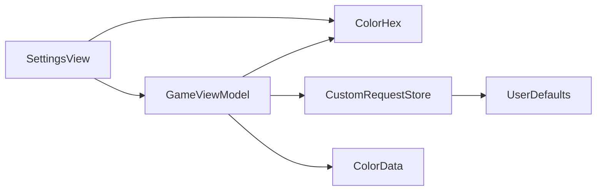

# Design Document: Custom Color Requests

## Overview

This baseline records the existing path from a player's named hex target to a locally retained `ColorRequest` and the setup picker. The SwiftUI settings form supplies input; `GameViewModel` validates and coordinates the request list; `CustomRequestStore` serializes it. No new runtime component or dependency is required.

### Goals

- Preserve the current entry, validation, persistence, and target-choice contracts.
- Keep custom targets available after app restart while leaving built-in targets unchanged.
- Identify the request seam consumed by round setup and three-device play.

### Non-Goals

- Edit, delete, share, or synchronize a saved request catalog.
- Define round transitions, color mixing, scoring, or network messages.

## Boundary Commitments

### This Spec Owns

- Local custom-request entry, input validation, and persisted catalog behavior.
- The `ColorRequest` identity, text, and sRGB target contract as it applies to custom requests.
- Exposure of built-in plus local custom requests to the settings target picker.

### Out of Boundary

- `round-flow-and-input` owns round start and target selection semantics after the picker hands over a choice.
- `color-mixing-and-scoring` owns use of the selected target in scoring.
- `local-three-device-play` owns host/client coordination and transfer of a host-selected target; it does not synchronize saved catalogs.

### Allowed Dependencies

- Existing `ColorRequest` and built-in `ColorData.requestPool` for target values and choices.
- Foundation `UserDefaults`, `Codable`, and `UUID` for local retention; SwiftUI for the existing settings form.
- `GameViewModel` is the integration seam. Storage and hex conversion do not depend on views or network mode.

### Revalidation Triggers

- Changes to `ColorRequest` fields, hex validation, the storage key or record format require the persistence tests and round-choice consumer to be rechecked.
- Changes to the available-request ordering or selected-request ID behavior require `round-flow-and-input` to recheck setup.
- Changes to host target transfer require `local-three-device-play` to recheck its snapshot contract without changing this catalog's ownership.

## Architecture

### Existing Architecture Analysis

`SettingsView` shows the picker and a sheet with request text, hex input, preview, Cancel, and Add. Its Add action calls `GameViewModel.addCustomRequest`. The main-actor view model loads custom requests at initialization, joins them after the seven built-in requests, saves a new array before publishing it, and selects the new ID. `CustomRequestStore` serializes a private record of UUID, text, and normalized hex under `customColorRequests.v1` in injected `UserDefaults`. No migration or third-party library is involved.

### Architecture Pattern & Boundary Map

The existing view → view model → store flow remains the sole write path. `ColorHex` is a focused value converter used by both the form preview and store. The model's available-request list is read by the picker and by round setup. The local-play snapshot mapper reads the selected round target; it never writes the guest's request store.

### Technology Stack

| Layer | Existing choice | Role |
| --- | --- | --- |
| UI | SwiftUI on macOS and iOS | Picker, sheet, validation preview |
| State | Swift 5, Observation, main-actor `GameViewModel` | Catalog and selected ID |
| Storage | Foundation `UserDefaults` and `Codable` | Local records |

## File Structure Plan

The baseline already exists. Only a focused regression test is an open implementation item.

### Existing Files

- `ColorGameTesting/Views/SettingsView.swift` — request picker, entry form, preview, and local setup control.
- `ColorGameTesting/GameViewModel.swift` — validation, save-before-publish, catalog assembly, and chosen ID.
- `ColorGameTesting/CustomRequestStore.swift` — `ColorHex` conversion and versioned local record storage.
- `ColorGameTesting/ColorData.swift` — `ColorRequest` value and immutable built-in request pool.
- `ColorGameTestingTests/CustomRequestStoreTests.swift` — current entry, persistence, selection tests; add malformed-storage regression here.
- `ColorGameTestingTests/ColorDataTests.swift` — built-in request pool baseline.

### Modified Files

- `ColorGameTestingTests/CustomRequestStoreTests.swift` — add tests for unreadable data and invalid decoded records; no production change is justified by the current evidence.

## Requirements Traceability

| Requirement | Design element |
| --- | --- |
| 1.1, 1.2, 1.3, 1.4 | `SettingsView` picker, form, preview, and disabled Add action |
| 2.1, 2.2, 2.3, 2.4 | `GameViewModel.addCustomRequest` and `ColorHex` validation |
| 3.1, 3.2, 3.3, 3.4 | `CustomRequestStore` save/load and view-model initialization |
| 4.1, 4.2 | `availableRequests`, selected ID, and settings picker |
| 4.3, 4.4 | Catalog and selected-ID read seam consumed by `round-flow-and-input` task 1.2 |

## Components and Interfaces

| Component | Domain | Intent | Requirements | Key dependency | Contract |
| --- | --- | --- | --- | --- | --- |
| `SettingsView` | UI | Enter and choose requests | 1.1, 1.2, 1.3, 1.4, 4.1 | `GameViewModel` P0 | State, action |
| `GameViewModel` | State | Validate, retain, and expose choices | 2.1, 2.3, 2.4, 3.1, 3.2, 4.1, 4.2 | Store, `ColorData` P0 | Service, state |
| `ColorHex` | Domain helper | Validate and convert six-digit hex | 1.3, 1.4, 2.2, 2.3 | Foundation P0 | Service |
| `CustomRequestStore` | Persistence | Save and load validated records | 3.1, 3.2, 3.3, 3.4 | `UserDefaults` P0 | Service |
| `ColorData` | Domain data | Built-in target values | 3.3, 4.1, 4.4 | Foundation P0 | State |

### Request contracts

- `ColorRequest` is a Swift value with `id: UUID`, `text: String`, and `targetSRGB: SIMD3<Double>`. A custom ID is generated when the request is accepted; built-in IDs are stable constants.
- `ColorHex.normalized(_:) -> String?` trims surrounding whitespace, accepts an optional first `#` and exactly six ASCII hex digits, then returns uppercase `#RRGGBB`. `ColorHex.sRGB(_:) -> SIMD3<Double>?` converts each byte to a 0...1 component. `ColorHex.string(from:) -> String` writes an uppercase hex target from sRGB components.
- `GameViewModel.addCustomRequest(text:hex:) -> Bool` requires mutable local rules and settings phase, trims the name, validates hex, saves the appended array, then updates `customRequests` and `selectedRequestID`. Rejection or failed save returns `false` before publication.
- `GameViewModel.availableRequests` is `ColorData.requestPool + customRequests`. The picker binds `selectedRequestID: UUID?`; `nil` denotes Random. `round-flow-and-input` task 1.2 reads this catalog and choice in `confirmSettings` to resolve a matching ID or sample the combined pool at round start.
- `CustomRequestStore.load() -> [ColorRequest]` decodes records and filters blank names or invalid colors. Missing or undecodable stored data yields an empty custom list. `save(_:) -> Bool` encodes all supplied requests and stores them under `customColorRequests.v1`. The injected `UserDefaults` enables isolated tests.

## Data Models

### Domain Model

Custom requests and built-in requests share `ColorRequest`; the catalog is an ordered array, with built-ins first. The app has no separate edit, delete, or duplicate-name rule. A request's UUID is the setup selection identity.

### Logical Data Model

The stored payload is a Codable array of private records `{ id: UUID, text: String, hex: String }`. It is device local, and only records that decode and pass load validation appear in the custom catalog. There is no cross-device catalog migration or synchronization. A selected host target travels as round state under `local-three-device-play` and does not become a saved guest request.

## Error Handling

The form disables Add for blank text or invalid hex and keeps the form open when addition fails. The view model rejects writes outside settings or by a local client. The store returns no custom requests for absent or undecodable data and skips individual decoded records with blank names or invalid colors. Built-in requests remain available. The current UI does not distinguish a persistence failure with a dedicated error message; this is recorded behavior, not a new requirement.

## Testing Strategy

- Existing `CustomRequestStoreTests` cover six-digit parsing, whitespace/case normalization, invalid entry, successful save and reload, preserved UUID/text/target, immediate selection, combined-list growth, and the downstream use of a custom choice in a round (1.3, 1.4, 2.1, 2.2, 2.3, 3.1, 3.2, 4.1, 4.2, 4.3).
- `round-flow-and-input` owns selected and Random target resolution in `confirmSettings`; existing `GameViewModelTests` cover Random within the available list and explicit built-in selection (4.3, 4.4). Existing local-play tests cover guests not inheriting the host's catalog; the network contract remains in its own spec.
- A focused missing regression should place undecodable bytes and a decoded array containing valid and invalid records in an isolated defaults suite, then assert that only valid custom requests appear and built-ins remain available (3.3, 3.4, 4.1). No production change is planned unless that check exposes a real defect.
