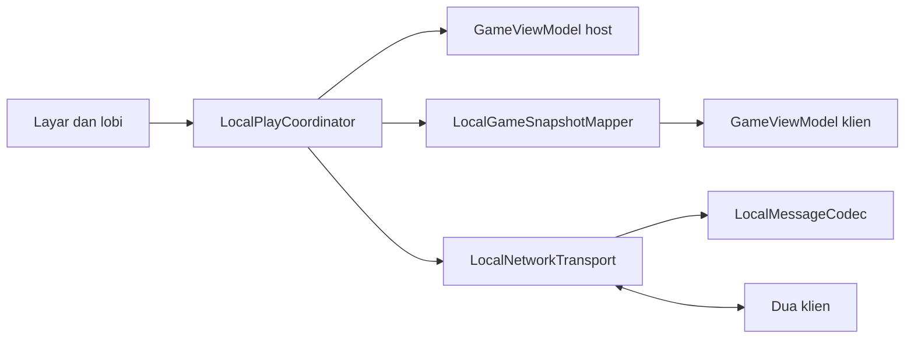
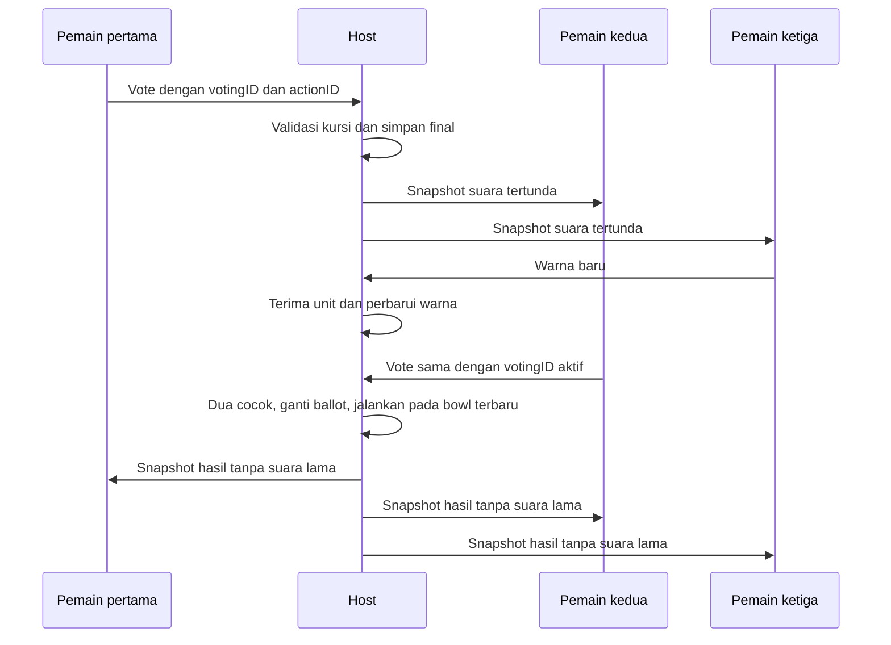

# Desain Teknis: Permainan Lokal Tiga Perangkat

## Overview

Playtesting Part II memperluas sesi lokal yang sudah tersedia dengan RYB saja, Manual/Auto Mix, serta keputusan mayoritas. Host tetap menjadi sumber keadaan, timer, pencampuran, dan skor. Setiap perangkat memperoleh satu kursi pemain dan mengendalikan dua warna berbeda.

Mix, Finish, Apply, dan Redo menjadi suara final dari seluruh kursi. Tindakan berlaku segera ketika dua pemain memilih hal yang sama. Pengaturan, Start Round, New Round, dan pengakhiran sesi tetap dikendalikan host. Transport Bonjour/TCP yang ada dipakai kembali.

### Goals

- Menyinkronkan mode campur, warna Auto, hasil, skor dan suara tertunda.
- Menjalankan mayoritas tepat sekali terhadap campuran terbaru.
- Mempertahankan suara, kursi dan ronde selama jeda/pemulihan koneksi.

### Non-Goals

Tidak menambah server internet, akun, migrasi host, skor individu, penyimpanan sesi, sinkronisasi katalog kustom, transport baru atau perombakan tampilan modern.

## Boundary Commitments

### This Spec Owns

- Pemilihan mode perangkat, lobi, kursi, hak pengaturan dan masukan, protokol, snapshot serta koordinasi sesi.
- Suara final, identitas pemungutan suara, keputusan dua suara, penolakan duplikasi/pesan lama dan distribusi status suara.
- Jeda/pemulihan serta integrasi tindakan jaringan dengan aturan ronde dan layar yang ada.

### Out of Boundary

Spesifikasi warna memiliki palet/perhitungan. Spesifikasi ronde memiliki `MixMode`, penugasan, eligibility, live/frozen color dan transisi. Spesifikasi permintaan kustom memiliki penyimpanan. Spesifikasi UI memiliki visual modern dan orientasi iPhone. Prasyarat pemulihan tes pada desain baseline sudah merupakan riwayat; tidak diulang sebagai pekerjaan baru.

### Allowed Dependencies

GameViewModel/GameState/GameModels, ColorData, mapper, codec, transport Network/Foundation yang ada, dan SwiftUI/Observation. Arah dependensi: model/aturan → mapper; model pesan → codec → transport; aturan, mapper dan transport → koordinator → UI. Domain tidak mengimpor Network atau tipe suara. Snapshot target kustom tidak menulis CustomRequestStore klien.

### Revalidation Triggers

Perubahan mode/fase/warna/palet memerlukan tes mapper dan integrasi. Perubahan pesan memerlukan gate versi codec/handshake. Perubahan timer/input/eligibility memerlukan tes keputusan dan recovery. Perubahan jumlah pemain, jaringan atau izin memerlukan validasi transport/perangkat.

## Architecture

### Existing Architecture Analysis

Implementasi memiliki host otoritatif, snapshot penuh bernomor revisi, riwayat penugasan, deduplikasi ID aksi, heartbeat serta token reconnect sementara. Versi protokol masih 1; host menjalankan Mix/Redo/Finish langsung dan menolak tindakan fase dari peer. Mapper belum mengenal Auto atau suara dan masih menerima CMYK.

### Architecture Pattern & Boundary Map



Seluruh penerimaan input/suara host berjalan sinkron pada MainActor. Klien tidak mengubah bowl secara optimistis, menjalankan timer, menghitung blend atau skor. Snapshot penuh memuat warna live dari host. Urutan penerimaan host menentukan unit yang sudah diterima saat keputusan berlaku.

### Technology Stack

| Lapisan | Teknologi yang dipertahankan | Peran |
| --- | --- | --- |
| State/UI | Swift 5, Observation, SwiftUI | Sesi dan tampilan iOS/macOS |
| Transport | Network NWListener/NWBrowser/NWConnection | Bonjour `_colorgame._tcp` dan TCP Wi-Fi lokal |
| Pesan | Foundation Codable JSON, frame panjang 32-bit | Pesan bertipe, batas frame 1 MiB, versi 2 |
| Validasi | XCTest, FakePeerNetwork | Host dan dua klien deterministik |

Info.plist NSLocalNetworkUsageDescription/NSBonjourServices dan entitlement macOS app-sandbox/network.client/network.server yang ada tetap diperlukan. Tidak ada perubahan API atau dependensi transport. Heartbeat 3 detik/batas 9 detik dan jalur recovery yang ada dipertahankan.

## File Structure Plan

### Modified Files

| Path | Tanggung jawab |
| --- | --- |
| `ColorGameTesting/LocalPlay/LocalPlayModels.swift` | Versi 2, Codable MixMode, LocalVoteAction/LocalVotingState, aksi vote dan snapshot mode/live/ballot |
| `ColorGameTesting/LocalPlay/LocalMessageCodec.swift` | Pertahankan framing/versi; dukung payload baru tanpa mengubah Hello/Reject |
| `ColorGameTesting/LocalPlay/LocalGameSnapshotMapper.swift` | Peta/validasi RYB, mode, pasangan berbeda, warna live dan suara |
| `ColorGameTesting/LocalPlay/LocalPlayCoordinator.swift` | Penerimaan vote host/peer, mayoritas, ballot lifecycle, publishing dan recovery |
| `ColorGameTesting/Views/GameView.swift` | Dua input lokal, suara Mix atau Apply/Redo untuk semua peran, status suara/jeda |
| `ColorGameTesting/Views/ResultView.swift` | Suara Finish/Redo semua peran dan pilihan final |
| `ColorGameTesting/Views/SettingsView.swift` | Pengaturan mode host dan RYB tetap; tiga kursi sebelum Start |
| `ColorGameTesting/Views/ScoreView.swift` | New Round tetap host-only |
| `ColorGameTesting/ContentView.swift` | Integrasi mode/phase/lifecycle sesi |
| `ColorGameTesting/Views/ModeSelectionView.swift`, `ColorGameTesting/Views/LocalLobbyView.swift` | Pilihan mode, kursi dan status/retry yang ada; verifikasi integrasi |
| `ColorGameTesting/LocalPlay/LocalPeerTransport.swift` | Kontrak transport dan jam/heartbeat injeksi yang ada; dipertahankan |
| `ColorGameTesting/LocalPlay/LocalNetworkTransport.swift`, `ColorGameTesting/ColorGameTesting.entitlements`, `ColorGameTesting2.xcodeproj/project.pbxproj` | Transport/izin yang ada; verifikasi tanpa membangun ulang |
| `ColorGameTesting/GameViewModel.swift`, `ColorGameTesting/GameState.swift`, `ColorGameTesting/GameModels.swift`, `ColorGameTesting/ColorData.swift` | Kontrak upstream; network hanya menyelaraskan hook applyRemoteState/serialization |
| `ColorGameTestingTests/LocalPlayModelsTests.swift`, `ColorGameTestingTests/LocalMessageCodecTests.swift` | Round-trip payload dan kompatibilitas/framing |
| `ColorGameTestingTests/LocalGameSnapshotMapperTests.swift` | Invarian snapshot mode/warna/penugasan/vote |
| `ColorGameTestingTests/LocalPlayCoordinatorTests.swift`, `ColorGameTestingTests/LocalPeerTransportTestSupport.swift` | Keputusan, input bersamaan, recovery dan transport palsu yang ada |
| `ColorGameTestingTests/LocalPlayInputIntegrationTests.swift`, `ColorGameTestingTests/GameViewModelLocalPlayTests.swift` | Input dan live blend host/klien |
| `ColorGameTestingTests/GameViewLocalPlayTests.swift`, `ColorGameTestingTests/ResultViewLocalPlayTests.swift`, `ColorGameTestingTests/ScoreViewLocalPlayTests.swift`, `ColorGameTestingTests/SettingsViewLocalPlayTests.swift` | Hak tindakan dan status suara di layar |
| `ColorGameTestingTests/ContentViewTests.swift`, `ColorGameTestingTests/ModeSelectionViewTests.swift`, `ColorGameTestingTests/LocalLobbyViewTests.swift` | Regresi mode/lobi/solo |

Semua berkas sudah tersedia. Deklarasi warna/ronde diselesaikan lebih dahulu; perubahan UI bersama dijalankan bertahap setelah kontrak jaringan, sehingga kepemilikan tidak tumpang tindih.

## System Flows



Jika dua suara pertama berbeda, suara ketiga menentukan mayoritas. Input dan hitung mundur playing tetap berjalan selama menunggu. Disconnect menjeda sesi, mempertahankan ballot, dan menolak input/suara baru sampai tiga kursi pulih. Auto Redo tidak mengubah fase/roundID tetapi mengganti votingID.

## Requirements Traceability

| Requirement | Summary | Components | Interfaces | Flows |
| --- | --- | --- | --- | --- |
| 1.1, 1.2, 1.3, 1.4, 1.5, 1.6, 1.7, 1.8 | Discovery, tiga kursi dan kegagalan | ModeSelectionView, LocalLobbyView, LocalPlayCoordinator, LocalNetworkTransport | Hello/Welcome, status kursi | Lobi |
| 2.1, 2.2, 2.3, 2.4, 2.5, 2.6, 2.7 | Pengaturan host dan mode RYB | SettingsView, LocalPlayCoordinator, LocalGameSnapshotMapper | Snapshot mode/target | Start dan New Round |
| 3.1, 3.2, 3.3, 3.4, 3.5, 3.6, 3.7 | Input peran dan warna bersama | GameView, LocalPlayCoordinator, LocalGameSnapshotMapper | Input ID/epoch, currentBlend | Playing |
| 4.1, 4.2, 4.3, 4.4 | Timer dan penugasan bersama | GameViewModel upstream, LocalPlayCoordinator | Snapshot epoch dan assignmentHistory | Tick/reassignment |
| 5.1, 5.2, 5.3, 5.4, 5.5, 5.6, 5.7, 5.8, 5.9, 5.10, 5.11 | Mayoritas hasil/skor dan reset host | LocalPlayCoordinator, GameView, ResultView, ScoreView | Vote dan transisi domain | Manual/Auto |
| 6.1, 6.2, 6.3, 6.4, 6.5, 6.6, 6.7, 6.8, 6.9 | Jeda, recovery dan suara dipertahankan | LocalPlayCoordinator, LocalNetworkTransport, LocalLobbyView | Token dan snapshot penuh | Disconnect/reconnect |
| 7.1, 7.2, 7.3, 7.4 | Solo langsung, satu skor dan batas sesi | ContentView, LocalPlayCoordinator, LocalNetworkTransport | Mode dan lifecycle | Pilih mode |
| 8.1, 8.2, 8.3, 8.4, 8.5, 8.6, 8.7, 8.8, 8.9 | Final vote, dua cocok, latest bowl | LocalVotingState, LocalPlayCoordinator, LocalGameSnapshotMapper | votingID, actionID, eligibility | Pemungutan suara |

## Components and Interfaces

| Komponen | Domain | Maksud | Requirements | Dependensi | Kontrak |
| --- | --- | --- | --- | --- | --- |
| LocalPlayModels | Pesan/state | Mode dan suara bertipe | 2.2, 3.7, 8.1, 8.3 | Model domain outbound P0 | State, Event |
| LocalMessageCodec/LocalNetworkTransport | Transport | Bingkai, discovery dan koneksi | 1.2, 1.7, 1.8, 6.1, 7.4 | Foundation/Network external P0 | Service, Event |
| LocalGameSnapshotMapper | Validasi | Snapshot konsisten lintas mode | 2.2, 2.3, 2.5, 3.1, 3.7, 6.3, 6.8 | Aturan/palet outbound P0 | Service |
| LocalPlayCoordinator | Sesi | Otoritas, suara, mayoritas dan pemulihan | 3.2, 3.6, 4.4, 5.2, 5.7, 6.9, 8.1, 8.4, 8.9 | Mapper/transport/aturan outbound P0; UI inbound P0 | State, Service, Event |
| Lobi dan layar | Presentasi | Input/peran/status yang dapat diakses | 1.1, 1.4, 2.1, 3.1, 5.1, 5.3, 5.6, 6.2, 8.3 | Koordinator outbound P0 | State |

### Model pesan dan ballot

```swift
enum LocalVoteAction: String, Codable { case mix, finish, apply, redo }
struct LocalVotingState: Codable {
    struct Vote: Codable { let player: PlayerID; let action: LocalVoteAction }
    let id: UUID
    var votes: [Vote]
}
// LocalGameAction: startRound, addColor(...),
// vote(action: LocalVoteAction, votingID: UUID), newRound
```

`WireMessage.Input` tetap membawa sessionID, roundID, actionID dan aksi bertipe. Payload vote tidak mengklaim pemain; sumber koneksi menentukan kursi. Hilangkan jalur host yang menjalankan Mix/Redo/Finish langsung melalui aksi jaringan. `MixMode` berasal dari domain, dengan Codable di lapisan protokol. `GameSnapshot` menambah `mixMode: MixMode`, `currentBlend: RGB?`, `voting: LocalVotingState?`; selectedModel tetap marker RYB, target lengkap, penugasan, counts per warna/urutan pertama, timer/epoch, lock, hasil/skor, pause/kursi dan revisi tetap tersedia.

Ballot baru dibuat saat ronde mulai. Keputusan mayoritas menghapus records dan membuat ID baru untuk playing/result berikutnya; settings/score/akhir sesi memakai nil. Warna, tick, pergantian penugasan, pause dan reconnect tidak mengganti ID. ID aksi yang telah diterima tetap disimpan sepanjang roundID yang sama, termasuk Redo/reconnect.

### LocalPlayCoordinator

Pertahankan `perform(_ action: LocalGameAction) -> Bool`, `chooseMode`, hosting/browsing/join/leave, dan callback transport. Tambahkan `castVote(_ action: LocalVoteAction) -> Bool`, `canVote(_:) -> Bool` dan observable `voting: LocalVotingState?`. UI memanggil castVote; coordinator membentuk vote memakai ballot terbaru dan mengirim melalui perform. Pada host, jalur lokal dan peer masuk ke penerimaan sinkron yang sama.

Syarat penerimaan: versi/session/round/votingID cocok; peer terikat kursi sah; tiga kursi terhubung; sesi tidak paused/recovering; actionID baru; pemain belum memilih; tindakan memenuhi eligibility domain. Suara pengganti ditolak tanpa mengubah records. Record valid diterbitkan jika belum mayoritas. Ketika dua records cocok, validasi ulang eligibility, kosongkan/ganti ballot sebelum mutasi domain, lalu jalankan satu tindakan terhadap semua unit yang telah diterima host. Hook didChange menerbitkan snapshot hasil beserta ballot baru. Tidak ada await antara pencatatan mayoritas dan mutasi domain.

Suara lama/ketiga setelah keputusan ditolak walau roundID/fase masih sama. Color input tetap melewati gate playing/unlocked, deduplikasi actionID dan validasi observedColorID terhadap assignmentHistory[epoch]; jangan melemahkan gate ini agar vote pada result diterima. Riwayat epoch mempertahankan warna yang terlihat saat input dilakukan, bukan menggantinya dengan slot terbaru.

Pengaturan/Start/New Round tetap host-only; start memerlukan tiga kursi. Pause tidak timbul hanya karena vote. Recovery mengirim snapshot penuh termasuk vote sebelum timer/input dilanjutkan; tidak menyimpulkan keputusan baru dari reconnect. Host Player1, klien Player2/3, token kursi sementara, penolakan perangkat keempat serta pengakhiran sesi tetap seperti implementasi saat ini.

### LocalGameSnapshotMapper

```swift
func makeSnapshot(from viewModel: GameViewModel,
                  session: SessionState,
                  voting: LocalVotingState?) throws -> GameSnapshot
func apply(_ snapshot: GameSnapshot, to viewModel: GameViewModel) throws
```

Kesalahan memakai `LocalPlayError.invalidMessage`; validasi dilakukan sebelum apply/publikasi. Koordinator klien hanya memperbarui voting/revisi setelah mapper berhasil, sehingga snapshot tidak diterapkan sebagian. Snapshot revisi lama/session lain ditolak oleh koordinator.

| Keadaan | Invarian |
| --- | --- |
| Settings | Tidak ada round/target/assignment/unit/live/result/score/ballot; Manual sesudah New Round |
| Manual playing | Unlocked, live/result/score nil; ballot ada; Mix hanya jika nonempty |
| Manual result | Locked nonempty, result ada, live/score nil; ballot ada; Finish/Redo |
| Auto playing | Unlocked, result/score nil; currentBlend ada tepat saat nonempty; ballot ada; Apply/Redo hanya nonempty |
| Score | Locked nonempty, frozen result dan score ada, live/ballot nil |

Validasi tipe/mode/fase, angka finite/rentang RGB0...1 dan score0...100, timer/durasi/epoch, ID palet RYB, counts positif/tidak duplikat dan jumlah unit maksimal 10.000 sesuai batas yang ada, tepat tiga assignment unik, setiap pair berbeda, seluruh lima warna dan satu duplikasi lintas pemain. Auto tidak boleh result. Vote memerlukan player unik dari kursi sesi, tindakan eligible dan maksimal records tertunda tanpa mayoritas. Record dari kursi yang sedang disconnected tetap sah ketika paused. Tidak ada blend/skor lokal saat apply klien. Target kustom memuat UUID/teks/sRGB; tidak disalin ke katalog persisten.

### Codec, transport dan UI

Codec mempertahankan `encode(_:) throws -> Data` dan parser `append(_:) throws -> [WireMessage]`; frame parsial/gabungan tetap didukung. Transport/heartbeat/retry tidak berubah. ProtocolVersion menjadi 2; Hello/Reject mempertahankan encoding v1 agar versi lama ditolak di handshake sebelum snapshot baru dikirim, sementara snapshot versi salah tetap ditolak.

Setiap perangkat menampilkan hanya input slot perannya dan tindakan vote yang eligible. Setelah memilih, tombol tindakan untuk kursi itu disabled sampai ballot baru; warna tetap aktif saat playing/unpaused. Status menampilkan siapa memilih tindakan apa dan bahwa dua suara sama menjalankan keputusan. Label peran, pilihan, progress dan pause tersedia untuk pembaca layar; jangan mengandalkan warna saja. Klien settings tetap baca-saja, score New Round hanya host.

## Data Models

Host menyimpan ballot, acceptedActionIDs, assignmentHistory dan token di memori. Snapshot memakai counts per warna dalam urutan kemunculan pertama; tidak memerlukan event log. Reconnect pada proses yang sama memulihkan snapshot/kursi/vote. Membuka ulang aplikasi tidak memulihkan sesi. Tidak ada perubahan UserDefaults.

## Error Handling

Versi salah, Wi-Fi/izin gagal, sesi penuh dan sesi tidak tersedia memakai error/retry yang ada. Vote tak sah, duplikat, stale atau saat pause tidak mengubah state. Frame/payload rusak menutup koneksi terkait sesuai codec/transport; host kemudian menjeda sesi aktif. Host hilang tidak memicu migrasi; klien menunggu recovery atau keluar. Status sesi berakhir membawa klien kembali ke pilihan mode.

## Testing Strategy

- Pertahankan discovery/Hello/kursi unik/keempat ditolak/host-only settings/target kustom tidak menulis storage/solo tanpa transport (1.1, 1.2, 1.3, 1.4, 1.5, 1.6, 1.7, 1.8, 2.1, 2.2, 2.3, 2.4, 2.5, 7.1, 7.2, 7.3, 7.4).
- Round-trip Manual/Auto dan default reset; validasi live warna, fase tidak sah, pasangan/duplikasi, record unik dan actions eligible dalam mapper/models (2.6, 2.7, 3.1, 3.7, 4.2, 8.8).
- Satu vote pending; dua cocok segera jalan; dua berbeda lalu vote ketiga; kedua/pengganti ditolak; semua kursi termasuk host menggunakan jalur yang sama. Periksa penerbitan sekali dan tidak menunggu ketiga (8.1, 8.2, 8.3, 8.4, 8.5, 8.9).
- Input/tick/reassignment berjalan setelah vote pertama, votes tidak reset, mayoritas Apply/Mix memakai unit terbaru; delayed third vote dan replay Auto Redo ditolak berdasarkan votingID/actionID (3.2, 3.3, 3.4, 3.5, 3.6, 4.1, 4.3, 4.4, 8.6, 8.7).
- Manual Mix/Redo/Finish dan Auto Apply/Redo melalui mayoritas menyinkronkan fase, result/score, lock/timer, target/assignments/countdown yang dipertahankan; New Round host-only mempertahankan kursi (5.1, 5.2, 5.3, 5.4, 5.5, 5.6, 5.7, 5.8, 5.9, 5.10, 5.11).
- Putus sebelum/selama ronde dan ballot, vote/input baru ditolak, records dipertahankan; held-snapshot fake memastikan recovery terkirim sebelum resume. Uji session end/leave (6.1, 6.2, 6.3, 6.4, 6.5, 6.6, 6.7, 6.8, 6.9).
- Codec vote dengan frame parsial/gabungan dan penolakan v1/v2 dua arah. Rendering memastikan tindakan semua peran, disabled setelah final, warna tetap aktif, status yang dapat diakses, score tetap host-only.
- Perangkat nyata: tiga iPhone/mac pada satu Wi-Fi, kedua mode, input serentak/dekat reassignment, dua suara, disconnect/reconnect/background dan izin jaringan. Simulator/fake tidak membuktikan dialog izin atau operasi jaringan nyata.

## Integration & Migration Notes

Urutan: deklarasi RYB → mode/transisi ronde → pesan/mapper v2 → coordinator mayoritas → functional UI/tes → modern UI. Semua perangkat memakai build protokol yang sama; tidak ada dukungan sesi campuran v1/v2. Jalankan macOS XCTest, build iOS dan smoke solo/lokal sebelum feature GO. Dokumen ini bukan laporan tes lulus.
