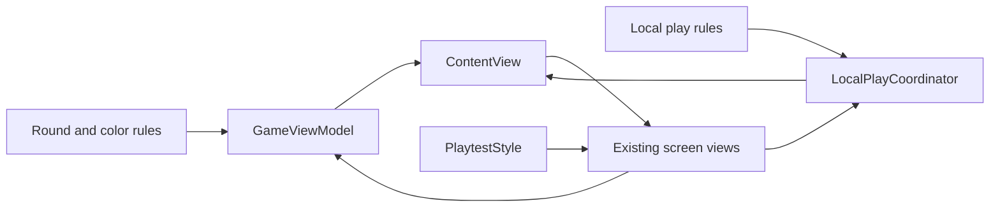
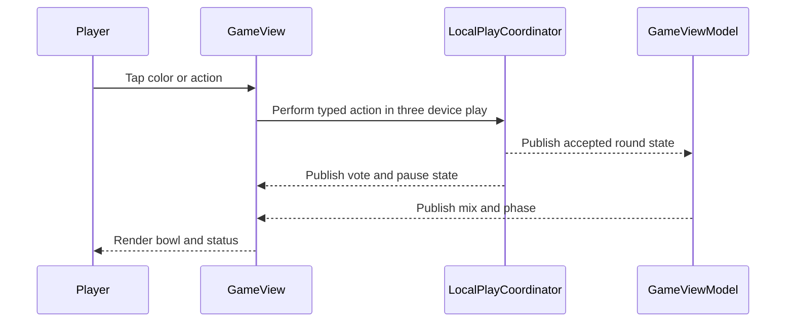

# Design Document: modern-playtest-ui

## Overview

This design updates the existing SwiftUI screens for clearer playtesting on iPhone and macOS. It starts with a landscape iPhone game layout: request at upper left, bowl in the center, and the local player's two colors at the lower corners. The same visual roles then carry through mode selection, setup, lobby, result, and score. The saved sketch in `assets/playtesting-part-ii-layout.png` is a placement reference, not a style specification.

The UI consumes the RYB-only round, Manual/Auto mode, calculated blend, valid actions, and three-device vote state supplied by adjacent specs. It does not derive game outcomes or count votes.

### Goals

- Keep the request, mix, player actions, countdown, and group status readable on supported iPhone landscape sizes.
- Give Manual Mix and Auto Mix distinct, accurate bowl and action presentations.
- Make every screen and accessible representation reflect the same current state.
- Preserve macOS keyboard play while improving its visual hierarchy.

### Non-Goals

- Redesign color math, assignment generation, vote rules, network transport, or custom-request storage.
- Support iPad or add a third-party UI package.

## Boundary Commitments

### This Spec Owns

- Visual roles, screen arrangement, accessible labels, and action/vote presentation in existing views.
- A shared style definition and pure vote-progress display used by those views.
- iPhone-only target family and landscape orientation configuration.
- UI rendering tests and iPhone layout/accessibility validation.

### Out of Boundary

- `GameViewModel` mix-mode transitions, live blend calculation, and action eligibility; owned by `round-flow-and-input` and `color-mixing-and-scoring`.
- `LocalPlayCoordinator` vote collection, majority decisions, pause/resume, and synced snapshots; owned by `local-three-device-play`.
- Request validation/persistence and score calculation.

### Allowed Dependencies

- Views may read `GameViewModel` and `LocalPlayCoordinator` observable state and call their existing typed actions. They may not mutate round, vote, or snapshot data directly.
- `GameView` may reuse `ColorBarView` for Manual Mix proportions and consume an upstream computed color for Auto Mix; it may not implement blending.
- The app target may use SwiftUI, Foundation, existing model types, and the existing Info.plist source. No new package is required.

### Revalidation Triggers

- Changes to the upstream `MixMode`, live blend, valid-action, or vote-progress contract.
- Changes to phase routing, player-role assignment, target-hint semantics, or snapshot timing.
- Changes to the iOS device family, deployment target, orientation metadata, or smallest supported iPhone size.

## Architecture

### Existing Architecture Analysis

`ContentView` owns the view model and coordinator and routes mode and phase. Each screen already receives those objects. `GameView.visiblePlayers` limits a three-device screen to the local player, while one-device play shows all three. `ColorBarView` is the current ratio pie, `ResultView` shows proportions, and `ScoreView` shows the match comparison. The UI retains that structure and replaces only presentation and action visibility.

The adjacent specs must first expose a typed `MixMode`, current blended display color, action eligibility, and a read-only vote-progress snapshot. The UI uses existing `GameViewModel` actions for one-device play and `LocalPlayCoordinator.perform(_:)` for three-device actions; the coordinator changes the latter to record votes instead of allowing only the host.

### Architecture Pattern & Boundary Map



Dependency direction is models and local coordination to routing to presentation for state; user actions flow back through the existing typed methods. `PlaytestStyle` and `VoteStatusView` contain no domain decisions. No new persistence or network protocol belongs to this design.

### Technology Stack

| Layer | Choice / Version | Role in Feature | Notes |
| --- | --- | --- | --- |
| UI | Swift 5, SwiftUI, iOS 17+ and macOS 27 target | Existing screens and adaptive layout | No new dependency |
| State | Observation `@Observable` | Read-only screen updates from existing owners | Mix/vote contracts arrive from adjacent specs |
| App configuration | Xcode project and Info.plist | iPhone-only family and landscape support | Verify built metadata |

## File Structure Plan

### Directory Structure

```text
ColorGameTesting2.xcodeproj/project.pbxproj       iPhone-only iOS target family
Config/LocalNetworkInfo.plist                     iPhone landscape orientations
ColorGameTesting/GameViewModel.swift               upstream round state and actions [unchanged here]
ColorGameTesting/LocalPlay/LocalPlayCoordinator.swift upstream votes and actions [unchanged here]
ColorGameTesting/LocalPlay/LocalPlayModels.swift   upstream typed actions [unchanged here]
ColorGameTesting/ColorMixer.swift                  upstream blend calculation [unchanged here]
ColorGameTesting/ContentView.swift                phase shell and screen routing
ColorGameTesting/Views/PlaytestStyle.swift        shared visual roles and button styles [new]
ColorGameTesting/Views/VoteStatusView.swift       pure per-player vote display [new]
ColorGameTesting/Views/ModeSelectionView.swift    play-mode choice
ColorGameTesting/Views/SettingsView.swift         setup and custom-request form
ColorGameTesting/Views/LocalLobbyView.swift       seats, connection and recovery status
ColorGameTesting/Views/GameView.swift             iPhone gameplay and mode-specific bowl/actions
ColorGameTesting/Views/ColorBarView.swift         Manual Mix proportion chart accessibility
ColorGameTesting/Views/ResultView.swift           Manual Mix result and votes
ColorGameTesting/Views/ScoreView.swift            comparison and new-round action
ColorGameTestingTests/ContentViewTests.swift      screen routing checks
ColorGameTestingTests/ModeSelectionViewTests.swift mode choice checks
ColorGameTestingTests/SettingsViewLocalPlayTests.swift setup checks
ColorGameTestingTests/LocalLobbyViewTests.swift   seats and error checks
ColorGameTestingTests/GameViewRenderingTests.swift bowl and control rendering
ColorGameTestingTests/GameViewLocalPlayTests.swift role and vote rendering
ColorGameTestingTests/ResultViewTests.swift       Manual result checks
ColorGameTestingTests/ResultViewLocalPlayTests.swift result vote checks
ColorGameTestingTests/ScoreViewTests.swift        comparison checks
ColorGameTestingTests/ScoreViewLocalPlayTests.swift local score checks
```

### Modified Files

- `ColorGameTesting2.xcodeproj/project.pbxproj` and `Config/LocalNetworkInfo.plist` — remove iPad from both iOS build configurations and declare both iPhone landscape orientations; inspect the built Info.plist.
- `ColorGameTesting/ContentView.swift` — apply consistent screen shell while preserving current phase and role routing.
- `ColorGameTesting/Views/ModeSelectionView.swift`, `SettingsView.swift`, `LocalLobbyView.swift` — apply shared hierarchy to mode, setup, custom-request, and connection states.
- `ColorGameTesting/Views/GameView.swift` and `ColorBarView.swift` — arrange iPhone three-device controls around the bowl; retain the one-device controls; render Manual proportions or Auto blended color based on upstream mode.
- `ColorGameTesting/Views/ResultView.swift` and `ScoreView.swift` — present Manual result actions and shared comparison consistently; show vote progress only in three-device play.
- The ten concrete `ColorGameTestingTests/` files listed above — extend rendering and action-visibility checks in their matching screen tests.

## System Flows



In one-device play the screen calls `GameViewModel` directly. Manual Mix keeps the ratio bowl and result screen; Auto Mix uses the upstream blended color in the gameplay bowl and applies directly to score. Vote progress is shown while the coordinator reports an incomplete action; the view never decides when the two-vote majority has been reached.

## Requirements Traceability

| Requirement | Summary | Components | Interfaces | Flows |
| --- | --- | --- | --- | --- |
| 1.1, 1.2, 1.3, 1.4, 1.5, 1.6 | Consistent headings, actions, phase and score | ContentView, PlaytestStyle, all screen views | Phase and valid actions | Screen routing |
| 2.1, 2.2, 2.3, 2.4, 2.5, 2.6 | Setup and lobby clarity | ModeSelectionView, SettingsView, LocalLobbyView | Selection, seat and error state | Screen routing |
| 3.1, 3.2, 3.3, 3.4, 3.5, 3.6, 3.7 | iPhone scope and landscape play | Project config, GameView, ContentView | Role, timer and assignments | Gameplay layout |
| 4.1, 4.2, 4.3, 4.4, 4.5 | Manual Mix | GameView, ColorBarView, ResultView, ScoreView | Mix and result state | Manual path |
| 5.1, 5.2, 5.3, 5.4, 5.5 | Auto Mix | GameView, ScoreView | Mix mode and live blend | Auto path |
| 6.1, 6.2, 6.3, 6.4, 6.5, 6.6, 6.7 | Vote and pause feedback | GameView, ResultView, VoteStatusView, LocalLobbyView | Vote progress and pause state | Vote path |
| 7.1, 7.2, 7.3, 7.4, 7.5, 7.6, 7.7, 7.8 | Accessible color and actions | All screen views, ColorBarView, VoteStatusView | Color labels, hint setting, state | Both paths |

## Components and Interfaces

| Component | Layer | Intent | Req Coverage | Key Dependencies | Contracts |
| --- | --- | --- | --- | --- | --- |
| ContentView | Routing UI | Show the current screen and shared shell | 1.1–1.6, 3.2 | GameViewModel P0, coordinator P0 | State |
| iOS target configuration | App config | Limit target to iPhone and advertise landscape | 3.1, 3.2 | Xcode target P0 | Configuration |
| PlaytestStyle | UI style | Shared heading, action, status and spacing roles | 1.2, 1.3, 2.1–2.6 | SwiftUI P0 | State |
| ModeSelectionView, SettingsView, LocalLobbyView | Setup UI | Present selected settings, seats and errors | 2.1–2.6 | GameViewModel P0, coordinator P0 | State |
| GameView, ColorBarView | Gameplay UI | Display request, bowl, assignments and valid actions | 3.3–3.7, 4.1–4.2, 5.1–5.3, 7.1–7.8 | Round state P0, mix color P0 | State |
| ResultView, ScoreView | Feedback UI | Show ratios, comparison and available next actions | 1.6, 4.3–4.5, 5.4–5.5 | Result and score state P0 | State |
| VoteStatusView | Shared UI | Display one status per player role | 6.1–6.7, 7.4 | Coordinator vote progress P0 | State |

### Presentation Contracts

The adjacent specs provide the following typed, read-only consumer contract before UI implementation begins:

| Source | Required state or action | UI use |
| --- | --- | --- |
| `GameViewModel` | `MixMode` (`manual` or `auto`), selected mode for setup and active round | Select controls and bowl presentation |
| `GameViewModel` | current computed blended color or `nil` for an empty mix; existing `round`, `mixResult`, `score`, and phase | Draw Auto bowl, Manual result, and score without mixing in views |
| `GameViewModel` | action eligibility and existing `pressMixButton`, `selectRedo`, `selectFinish`, `startNewRound` | Disable invalid controls and forward one-device actions |
| `LocalPlayCoordinator` | local `PlayerID`, pause/seat/error state, typed vote progress per `PlayerID`, action eligibility, `perform(LocalGameAction)` | Show local pair and each vote; forward three-device actions |

`VoteStatusView` accepts the coordinator's immutable vote-progress value and the local `PlayerID`; it renders the three role rows and pending/completed labels. It does not mutate the vote state. `GameView` chooses the Manual composition view or Auto solid bowl according to `MixMode`. The iPhone three-device layout uses safe-area-aware available size: a leading request area, centered bowl/action column, and two lower color controls. Secondary information may scroll on short screens; the two color controls and primary action remain visible. The one-device layout keeps all three player pairs accessible, and macOS keeps the visible Q/W, B/N, O/P assignments.

## Data Models

No new persisted domain model belongs to this spec. `PlaytestStyle` holds only presentation values. Vote progress and mix mode are upstream typed state; the UI does not serialize, count, or own them.

## Error Handling

- Invalid or empty-mix actions use upstream eligibility to appear unavailable; the view does not infer the rule from its own copy of round data.
- A paused local session displays the disconnected role and disables play and vote controls while preserving the last visible bowl and vote state.
- Connection and request-validation errors remain owned by existing flows; the redesigned screens keep their messages and recovery controls visible.
- Missing calculated blend renders an empty bowl rather than a fabricated color. The target hint remains hidden, including accessibility metadata, until enabled or the score phase.

## Testing Strategy

- **Rendering and state tests**: Extend matching XCTest view tests to check mode selection, settings selection, lobby seats/errors, Manual proportions, Auto solid bowl/no pie, vote status on all roles, paused controls, and score/new-round visibility against 1.1–7.8.
- **Orientation/configuration**: Verify iOS Debug and Release build settings advertise iPhone-only device family and both landscape orientations; inspect the built Info.plist when Xcode is available (3.1, 3.2).
- **iPhone UI paths**: On a small and large iPhone simulator, check three-device Manual Mix, Auto Mix, pending majority vote, disconnect pause, one-device six controls, custom-request form, result, and score for safe-area overlap and reachable actions (2.4, 3.3–3.7, 4.1–6.7).
- **Accessibility**: Check VoiceOver labels for color controls, bowl, result and target swatches, vote status, and hint-off secrecy; test larger text and macOS keyboard labels (7.1–7.8).

## Integration and Validation Notes

- Implement adjacent `color-mixing-and-scoring`, `round-flow-and-input`, and `local-three-device-play` consumer contracts before wiring mode and vote UI. Do not add duplicate rule logic to views as a temporary bridge.
- The iOS scheme currently has no test action and `xcodebuild` is unavailable under the active Command Line Tools developer directory. Use existing macOS XCTest checks where possible, then validate landscape orientation, built metadata, and touch ergonomics in Xcode on iPhone simulator/device.
- Revalidate this design if upstream names or vote semantics differ from the table above; preserve the ownership boundary when adapting.

## Approved iPhone compact layout refinement

The host settings room uses one vertical scroll owner for embedded lobby and setup content. Connected seats appear in one compact row; the request library is collapsed initially. Landscape gameplay and Manual result use fixed, non-scrolling layouts. Gameplay places the request at the upper left, run timer above the central bowl, Day/client/mistake progress at the upper right, color controls at the lower corners, and mix actions and compact final-vote indicators below the bowl. Solo retains all six color controls. iPhone gameplay removes visible role and color reassignment countdown labels; iPhone run status removes the passing threshold. These changes affect presentation only: countdowns, grading, authority, votes and disconnect pauses retain their behavior.

The iPhone score screen also uses a fixed landscape layout: brief outcome, run progress, compact score and side-by-side mix/target swatches, with Next Client or host-waiting feedback kept visible without scrolling.

## Request emphasis and outcome feedback

The landscape iPhone request card uses a warm contrasting fill and border and aligns with the Day/client card. Remaining lives appear above the request as filled/empty hearts, replacing mistake-count text; unlimited lives and large configured limits use a heart with infinity or a numeric count. Scores prioritize green PASS/checkmark or red MISS/cross with a secondary percentage. Client-timer mode uses a person icon. Both timer modes show a centered, dismissible request overlay when a new client starts; timeout notices identify the lost life when limits apply. The overlay dims the background and blocks underlying touch controls while the timer continues. Its automatic three-second task cancels when the request or view changes.

## Shared header and request overlay refinement

On iPhone, gameplay, Manual breakdown, and score use one shared top header: lives on the left, timer centered, Day/client progress beside Lobby on the right. Guests retain Leave. Remove the additional outer navigation row on these screens. The large request overlay has an accessible X button and scrollable full text; new-client notices appear in both timer modes and close automatically after three seconds. Truncated gameplay requests use a bold See more control to reopen the overlay until explicitly dismissed. A parent-owned last-noticed round ID prevents Redo from announcing the same client again. Returning to settings/lobby preserves existing authority and session behavior.

## Manual breakdown continuity

The iPhone Manual breakdown retains the same request card position and full-request overlay as gameplay. Show the mixed color beneath the request, with the compact ingredient list on the right. Ingredients show only color names and unit counts, including accessibility labels. Voting status sits immediately above Redo/Finish in the right column. Preserve the shared top header and non-scrolling layout.

## Simplified mix summary

Replace the ingredient table with the reference layout: Your Mix above a broad swatch, with five vertically ordered palette dots and numeric unit counts alongside it, including zero counts. Keep spoken color names for accessibility. On iPhone, place this summary beside the unchanged request card; keep voting directly above Redo/Finish, without scrolling.

## Bowl continuity and longer request previews

Request cards show two preview lines in compact cards and three in taller cards before See more. Gameplay and breakdown reuse the same circular bowl component. In iPhone three-device play, breakdown uses the same center-column bowl size and position as gameplay, with a noninteractive YOUR MIX label in the former Mix-action position. Keep palette dots/counts and voting above compact Redo/Finish controls in the right column.

The new-client and full-request overlays display the target color swatch when Show Target Color Hint is enabled, including its accessible RGB description; hide it when hints are disabled. Both gameplay and breakdown pass the current target and shared hint setting to the notice.

Center the result color-count column vertically in the area above voting/actions. Restore full-size typography and wider, equal-width Redo/Finish controls, keeping their footer aligned to the right safe area and voting immediately above.

## Mac parity with the approved iPhone layout

Mac and iPhone now share adaptive gameplay, breakdown and score layouts, request cards/notices, lives/timer/progress headers, compact votes, and one lobby/settings scroll owner. Mac retains key labels and six solo controls, uses larger bowls/comparison swatches where space permits, and has a 680×480 minimum content size with a 1000×600 default window. Keep the solo bowl position consistent across gameplay and result. Preserve Lobby/Leave navigation even when active-screen data is missing. The accepted iPhone sizes and layouts remain unchanged for normal play.
