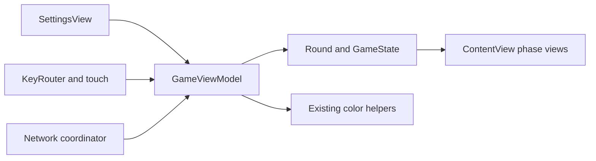
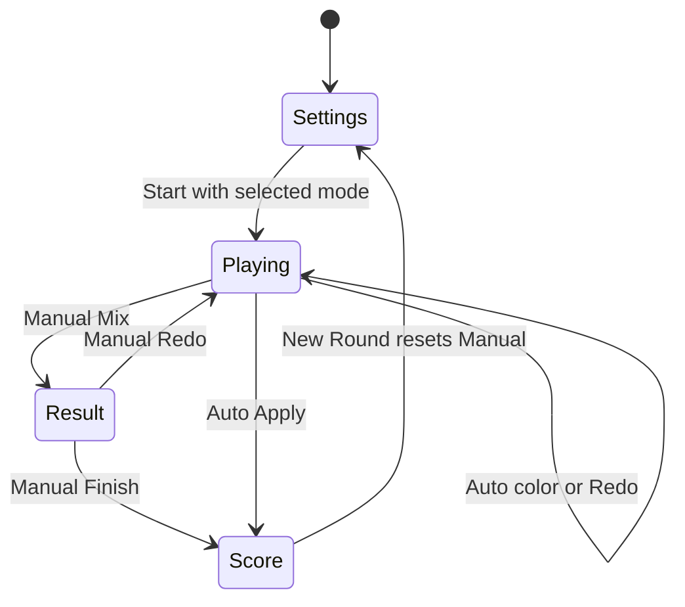

# Design Document: Round Flow and Input

## Overview

Extend the existing main-actor `GameViewModel` with RYB-only setup, distinct player pairs, and Manual/Auto Mix. Retain four phases and one shared three-player mix. Manual keeps its review step; Auto updates its bowl while playing and scores directly on Apply.

The same guarded domain actions serve solo and the authoritative network host. Network permission, voting and pause gates remain in the coordinator; modern styling remains in the UI spec.

### Goals

- Default setup and every New Round to Manual Mix with fixed RYB.
- Guarantee two different colors for each player at start and every reassignment.
- Expose mode-aware action eligibility and live/frozen colors to views and network integration.

### Non-Goals

No new blending/scoring formula, custom request schema, networking, voting logic, iPhone layout overhaul, timer service or independent round controller.

## Boundary Commitments

### This Spec Owns

- `MixMode`, setup defaults, `Round`/`GameState` shape and live-color invariant.
- Target resolution, assignments, input, timer lifecycle and guarded domain transitions.
- Functional solo UI mode selector and mode-specific action forwarding.

### Out of Boundary

Palette/math/result formatting: color spec. Request validation/storage: custom request spec. Connected-seat authority, votes, snapshots and pause/recovery: local network spec. Modern layout/landscape: UI spec.

### Allowed Dependencies

`ColorData`, available requests, `ColorMixer`, `ColorConverter`, `ScoreCalculator`, SwiftUI, Observation, Foundation Timer and existing AppKit input. Dependency direction: models/palette/math → `GameViewModel` → phase views. Domain code does not import Network or voting types.

### Revalidation Triggers

Changes to state fields, phases, eligibility or timer behavior require mapper/coordinator tests. Assignment/ID changes require network validation and visible-slot tests. Live/frozen color changes require calculation and UI tests. Request resolution changes require custom-request integration checks.

## Architecture

### Existing Architecture Analysis

`ContentView` routes settings/playing/result/score; `GameViewModel` owns mutations and timer. Current setup requires a model selection, assignments allow same-player duplicates, and only Manual transitions exist. Solo input and accepted host input have separate append paths; both must maintain live Auto color after accepting exactly one unit.

### Architecture Pattern & Boundary Map



### Technology Stack

Swift 5 value types, main-actor Observation/SwiftUI, Foundation Timer and AppKit remain in place. XCTest uses the macOS scheme. No new dependency, framework or platform minimum is introduced.

## File Structure Plan

### Modified Files

| Path | Responsibility |
| --- | --- |
| `ColorGameTesting/GameModels.swift` | Add shared `MixMode.manual`/`.auto`; preserve players, slots, keys and four phases |
| `ColorGameTesting/GameState.swift` | Default fixed RYB and Manual selection; immutable `Round.mixMode`; optional `currentBlend` separate from frozen `mixResult` |
| `ColorGameTesting/GameViewModel.swift` | Defaults, mode selection, distinct assignments, eligibility, accepted-unit/live-color update and mode transitions |
| `ColorGameTesting/Views/SettingsView.swift` | Fixed RYB label, Manual/Auto selector and existing target/duration/hint/start controls |
| `ColorGameTesting/Views/GameView.swift` | Manual contributions/Mix versus Auto swatch/Apply/Redo; preserve input labels and controls; replace CMYK previews |
| `ColorGameTesting/Views/ResultView.swift`, `ColorGameTesting/Views/ScoreView.swift` | Existing direct Redo/Finish/New Round forwarding; color spec owns feedback presentation |
| `ColorGameTesting/ContentView.swift`, `ColorGameTesting/KeyRouter.swift`, `ColorGameTesting/Views/ColorBarView.swift` | Existing read-only routing, physical-key and Manual chart dependencies; verify integration |
| `ColorGameTesting/ColorData.swift`, `ColorGameTesting/ColorMixer.swift`, `ColorGameTesting/ColorConverter.swift`, `ColorGameTesting/ScoreCalculator.swift`, `ColorGameTesting/CustomRequestStore.swift` | Upstream dependencies; no domain formulas/storage owned here |
| `ColorGameTestingTests/GameModelsTests.swift`, `ColorGameTestingTests/GameStateTests.swift` | Mode/state defaults and value contracts |
| `ColorGameTestingTests/GameViewModelTests.swift`, `ColorGameTestingTests/GameViewModelFlowTests.swift` | Assignment, input, timer, modes, guards and reset flows |
| `ColorGameTestingTests/GameViewRenderingTests.swift`, `ColorGameTestingTests/ContentViewTests.swift`, `ColorGameTestingTests/ResultViewTests.swift` | Functional rendering/phase routes and fixture migration |
| `ColorGameTestingTests/KeyRouterTests.swift`, `ColorGameTestingTests/CustomRequestStoreTests.swift` | Existing input/persistence regression gates |

No new source file is necessary. Shared edits are staged after color declarations and before network integration. Coordinator changes belong to the network spec.

## System Flows



Contribution and timer mutations remain allowed only in unlocked playing. Pending network votes add no domain phase or lock. Disconnect pause is applied through existing coordinator hooks.

## Requirements Traceability

| Requirement | Summary | Components | Interfaces | Flows |
| --- | --- | --- | --- | --- |
| 1.1, 1.2, 1.3, 1.4, 1.5, 1.6, 1.7 | Fixed RYB setup, target, defaults and mode | GameState, GameViewModel, SettingsView | selectMixMode, confirmSettings | Settings to playing |
| 2.1, 2.2, 2.3, 2.4, 2.5, 2.6, 2.7 | Shared round and distinct assignments | Round, GameViewModel, GameView | Assignment invariants | Start and reassignment |
| 3.1, 3.2, 3.3, 3.4, 3.5 | One-unit platform input and guards | GameViewModel, KeyRouter, GameView | addColor, acceptColor, pressKey | Unlocked playing |
| 4.1, 4.2, 4.3, 4.4, 4.5 | Countdown and preserved mix | GameViewModel | timerTick, triggerReassignment | Playing timer |
| 5.1, 5.2, 5.3, 5.4, 5.5, 5.6, 5.7 | Manual review and reset | GameViewModel, ContentView, ResultView, ScoreView | Eligibility and direct actions | Manual state flow |
| 6.1, 6.2, 6.3, 6.4, 6.5, 6.6, 6.7, 6.8 | Live Auto, Apply/Redo and reset | GameState, GameViewModel, GameView | currentBlend, selectApply, selectRedo | Auto state flow |

## Components and Interfaces

| Component | Domain | Intent | Requirements | Dependencies | Contracts |
| --- | --- | --- | --- | --- | --- |
| `MixMode`, `Round`, `GameState` | State | One immutable round mode and separate live/frozen colors | 1.5, 1.7, 2.1, 6.1 | Color/request values outbound P0 | State |
| `GameViewModel` | Domain orchestration | Setup, assignment, input, timing and transitions | 1.1, 1.6, 2.2, 2.6, 2.7, 3.1, 3.5, 4.3, 5.2, 6.4 | Math/catalog outbound P0; views/coordinator inbound P0 | State, Service |
| `KeyRouter` | Input | Preserve physical key mapping | 3.2, 3.4 | Player/slot types outbound P0 | Service |
| `SettingsView`, `GameView`, `ContentView` | Presentation | Expose setup, playing state and mode actions | 1.2, 1.3, 1.4, 2.3, 2.4, 2.5, 3.3, 6.2, 6.8 | View model outbound P0 | State |
| `ResultView`, `ScoreView` | Presentation seam | Forward direct solo actions | 5.3, 5.4, 5.5, 6.6 | View model outbound P0 | State |

### Shared state contract

```swift
enum MixMode: String, CaseIterable { case manual, auto }
// GameState: selectedModel: ColorModel = .ryb; selectedMixMode: MixMode = .manual
// Round: let mixMode: MixMode; colorModel always .ryb
// GameState: currentBlend: SIMD3<Double>?; mixResult: SIMD3<Double>?; score: Double?
```

Keep the RYB marker for existing palette/wire calls; remove the model-choice setter and UI. Start no longer waits for palette selection. `selectedMixMode` may change only in settings under existing solo/host authority. Round mode is captured at start and does not change during that round.

`currentBlend` is stored because the host sends it and clients must apply it without calculating locally. It is nonnil exactly for a nonempty Auto playing mix, and is updated once by the shared accepted-unit helper after either solo or host acceptance. It is nil in empty, Manual, settings and score states. Auto Apply freezes the freshly calculated current color into `mixResult` and clears live color. Manual `mixResult` exists only in result/score. Score is absent until scoring. No cached ratios are introduced.

### GameViewModel service contract

Existing `confirmSettings()`, `addColor(player:slot:)`, `acceptColor(_:for:)`, `timerTick()`, `triggerReassignment()`, `pressMixButton()`, `selectRedo()`, `selectFinish()` and `startNewRound()` remain. Add `selectMixMode(_ mode: MixMode)` and `selectApply()`; expose `selectedMixMode`, `currentBlend`, and `canMix/canApply/canRedo/canFinish/canNewRound: Bool`.

| Action | Eligibility | Postcondition |
| --- | --- | --- |
| Start | Settings, available request and solo/host mutation authority | Empty unlocked RYB round, selected mode, new round ID and epoch zero, duration countdown, no live/frozen color or score |
| Color | Playing, unlocked, assigned valid slot/color | One accepted unit appended; Auto live color updated; notify once |
| Mix | Manual, playing, unlocked, nonempty | Lock, stop timer/keys, freeze blend, enter result |
| Finish | Manual, locked result with blend | Score frozen blend, enter locked score |
| Apply | Auto, playing, unlocked, nonempty | Blend latest units, freeze color, lock/stop timer and keys, score, enter score directly |
| Redo | Manual locked result, or Auto unlocked nonempty playing | Clear units/live/frozen color/score; retain target, assignments, remaining seconds and round mode; resume playing |
| New Round | Score | Settings; clear round, request selection, colors, score, round ID and epoch; reset Manual/fixed RYB; retain duration, hint and request catalog |

Eligibility represents domain state only; network adds seat/pause/vote guards. Invalid actions are no-ops and do not notify a fake transition. Client mutation remains prohibited; `applyRemoteState` applies validated host values, including mode/live color, without starting timer/keys or calculating.

### Assignment and timer contracts

Every assignment has three player pairs, five unique palette colors represented across six slots, exactly one color occurring twice, and distinct colors within each pair. Preserve shuffle-based allocation with a bounded correction for a duplicated pair; no unbounded retry loop. Use the same allocation on round start and timer reassignment.

Timer starts at selected duration (15/30/45/60/90; default45). Every unlocked playing tick decreases seconds; zero reassigns all pairs, increments epoch and resets duration while preserving units/live color. Redo preserves remaining seconds. Leaving playing stops timer/keys. Network pause stops timer through existing hooks, without discarding state.

### Functional UI contract

Settings preserves Random/available targets, saved requests, durations and hint default off, and exposes mutually exclusive Manual/Auto choices defaulting Manual. Gameplay shows target text, optional hint, countdown and assignments. Solo iOS retains all six named touch controls; macOS retains Q/W, B/N, O/P.

Manual renders contribution proportions and Mix; Auto renders `currentBlend` or empty state, no ratio chart and no Mix, and offers Apply/Redo on gameplay. Button disabled states use shared eligibility; color buttons keep their accessible names and one-unit hints. Manual Result and Score retain their current routes. Modern bowl placement and landscape configuration remain downstream work.

## Data Models

`GameState` holds setup selection plus optional round/live/frozen/score values. `Round` is the aggregate for target, fixed RYB marker, immutable mix mode, three assignments and ordered units/lock. Player/slot/phase cardinalities remain three/two/four. Round ID and assignment epoch remain view-model seams for network validation. No persistent round or score record is introduced; saved custom requests retain their existing schema.

## Error Handling

Wrong-phase/mode, locked and empty actions are no-ops. Unknown keys add nothing. Missing active round renders its existing fallback. Palette invariants are trusted in-process and tested; inbound snapshot validation belongs to network. Missing request choice resolves Random from available requests; custom catalog construction stays upstream.

## Testing Strategy

- Test Manual default, no model-selection gate, mode retention, explicit/Random target, duration/hint defaults and New Round retention/reset (1.1, 1.2, 1.3, 1.4, 1.5, 1.6, 1.7, 5.5, 5.6, 6.6).
- Replace the test requiring same-player duplicates. Across start/reassignment samples assert all five colors, `[1,1,1,1,2]` counts and three distinct pairs; include a deterministic duplicated-pair correction fixture (2.1, 2.2, 2.6, 2.7, 4.3).
- Verify exact current-slot one-unit input, unknown keys, wrong phase and lock no-ops, reassigned slots, retained contributions, tick/reset and stopped timer (3.1, 3.2, 3.4, 3.5, 4.1, 4.2, 4.3, 4.4, 4.5).
- Manual end-to-end: empty Mix rejected → contributions → result/ratios → Redo preserving target/time/pairs → Mix → Finish → New Round; invalid mode/phase calls do nothing (5.1, 5.2, 5.3, 5.4, 5.5, 5.6, 5.7).
- Auto end-to-end: empty Apply/Redo rejected → every accepted unit matches mixer color → Redo empty → add → Apply score/frozen latest blend and stop timer → New Round Manual. Cover both solo append and host accepted-color paths, invalid actions and absence of Manual result (6.1, 6.2, 6.3, 6.4, 6.5, 6.6, 6.7, 6.8).
- Render request/hint/assignments/timer and correct mode controls, and preserve six solo iOS controls (2.3, 2.4, 2.5, 3.3). iOS scheme lacks a test action: require iOS build plus simulator/device smoke.

## Integration & Migration Notes

Color declarations land first. Network schema/mode/live-color support must land before three-device mode is ready. Existing modern UI task 1.1 stays blocked until shared eligibility/currentBlend/voting contracts exist. Do not reset custom storage. Use macOS XCTest, iOS build, both-mode solo smoke and three-device validation before claiming feature readiness.
