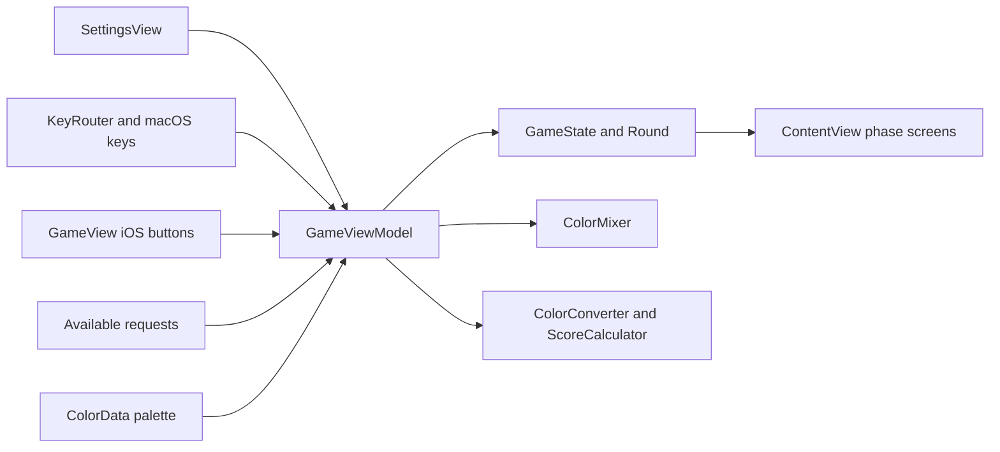
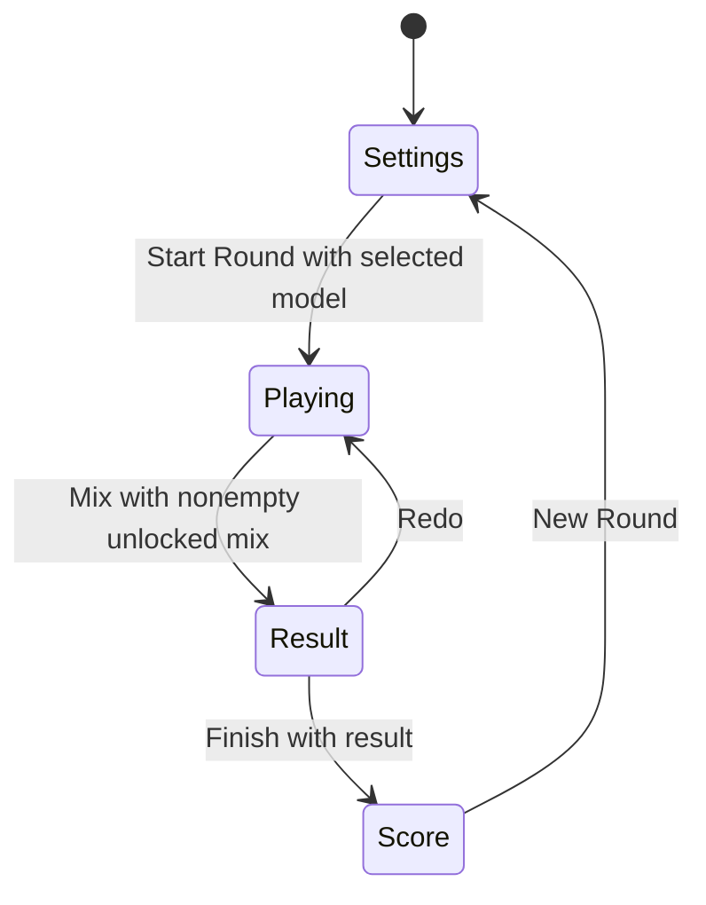

# Design Document: Round Flow and Input

## Overview

This baseline records how a single-device group configures and completes a three-player round. `ContentView` shows the current phase; `GameViewModel` owns setup state, one round, input, timer, and transitions; SwiftUI screens forward actions and render current state. The calculation and request catalog helpers remain upstream dependencies.

### Goals

- Preserve the implemented settings → playing → result → score → settings contract.
- Identify which player action changes the one shared mix on macOS and iOS.
- Keep phase, request, and calculation seams explicit for later playtesting changes.

### Non-Goals

- Change gameplay, assignments, timing, controls, or persistence.
- Define custom-request validation/storage or color and score formulas.
- Define mode selection, host/client authority, network messages, or synchronized snapshots.

## Boundary Commitments

### This Spec Owns

- Single-device setup choices and the use of a selected target when starting a round.
- The `GamePhase` sequence, `Round` state, three-player assignments, direct local input, countdown, and guarded action transitions in `GameViewModel`.
- The direct single-device UI action seam: settings Start Round, playing Mix and color controls, result Redo/Finish, score New Round.

### Out of Boundary

- `custom-color-requests` owns saved request validation, storage, and availability in the picker. This spec owns resolving that choice into a new round.
- `color-mixing-and-scoring` owns blending, proportions, result breakdown, perceptual scoring, and result/score display details. This spec owns when those calculations are invoked and when their screens appear.
- `local-three-device-play` owns mode selection, lobby, network input, host/client authority, pause/reconnect, and synchronized display. Its coordinator uses the shared phases without owning direct single-device actions.

### Allowed Dependencies

- `ColorRequest` and `GameViewModel.availableRequests` supply target identity, text, and sRGB; `ColorData.colors(for:)` supplies the selected five-color palette.
- `ColorMixer.blend` supplies a result for an accepted nonempty mix; `ColorConverter` and `ScoreCalculator` supply a score after Finish.
- SwiftUI, Foundation `Timer`, and the macOS AppKit key monitor implement the existing local controls. No new dependency or persistent round storage is needed.
- Dependency direction remains request/palette and calculation helpers → view-model round state → phase views; views forward actions into the view model and do not mutate the mix themselves.

### Revalidation Triggers

- A change to phases, `Round` fields, mix locking, assignment epoch, or timer state requires `local-three-device-play` snapshot and authority checks.
- A change to the available-request list or selected ID semantics requires the setup choice and custom-request spec to be rechecked.
- A change to result/score invocation or values requires the color calculation spec and result/score views to be rechecked.
- A change to the palette's five distinct colors or player/slot count requires assignment, key, touch, and rendering tests to be rechecked.

## Architecture

### Existing Architecture Analysis

The current app uses Swift value types for `GameState`, `Round`, assignments, and mix units. The main-actor, observable `GameViewModel` is the single authority for direct local mutations. `ContentView` selects `SettingsView`, `GameView`, `ResultView`, or `ScoreView` from `GamePhase`. In single-device mode each view calls a view-model action directly; coordinator calls in the same views are reserved for the adjacent network spec. Round state is transient; a new round does not erase saved custom targets.

### Architecture Pattern & Boundary Map

The diagram shows the existing direct local path. `LocalPlayCoordinator` is deliberately omitted: its host/client protocol consumes state and phase changes but belongs to `local-three-device-play`. The only calculation calls in this spec are the invocation seams; algorithms stay upstream.

### Technology Stack

| Layer | Existing choice | Role |
| --- | --- | --- |
| UI and state | Swift 5, SwiftUI, Observation | Phase routing, visible settings and controls, observable view model |
| Timing | Foundation `Timer` | One-second playing countdown |
| macOS input | AppKit local key-down monitor | Forward physical key codes into `KeyRouter` |
| Domain | Swift value types and existing helpers | Round state, palette, request, result and score seams |
| Validation | XCTest on the macOS shared scheme | State, input, and rendering checks |

## File Structure Plan

All listed files already exist; no source file needs modification for this baseline.

| Existing file | Responsibility in this spec |
| --- | --- |
| `ColorGameTesting/GameModels.swift` | Four `GamePhase` cases, three `PlayerID` values, two `ColorSlot` values, and key labels/codes |
| `ColorGameTesting/GameState.swift` | Transient `GameState`, `Round`, `PlayerAssignment`, shared `Mix`, and color units |
| `ColorGameTesting/GameViewModel.swift` | Setup choices, round creation, random assignments, input guards, timer, and transitions; calculation integration seam |
| `ColorGameTesting/KeyRouter.swift` | macOS key-code-to-player/slot mapping |
| `ColorGameTesting/ContentView.swift` | Route the selected single-device session by phase |
| `ColorGameTesting/Views/SettingsView.swift` | Model, target, duration, hint, and Start Round controls |
| `ColorGameTesting/Views/GameView.swift` | Request, assignments, timer, platform controls, and Mix action |
| `ColorGameTesting/Views/ColorBarView.swift` | Shared-mix visualization consumed by `GameView`; proportion math is upstream |
| `ColorGameTesting/Views/ResultView.swift` | Direct Redo and Finish action seam; result presentation is upstream |
| `ColorGameTesting/Views/ScoreView.swift` | Direct New Round action seam; score presentation is upstream |
| `ColorGameTesting/ColorData.swift` | Existing request pool and five-color palette dependency |
| `ColorGameTesting/ColorMixer.swift`, `ColorGameTesting/ColorConverter.swift`, `ColorGameTesting/ScoreCalculator.swift` | Existing calculation dependencies, owned by `color-mixing-and-scoring` |
| `ColorGameTestingTests/GameModelsTests.swift`, `ColorGameTestingTests/KeyRouterTests.swift` | Phase, player, slot, and physical-key contracts |
| `ColorGameTestingTests/GameViewModelTests.swift`, `ColorGameTestingTests/GameViewModelFlowTests.swift` | Setup, assignment, input, timer, and transition checks |
| `ColorGameTestingTests/GameStateTests.swift`, `ColorGameTestingTests/GameViewRenderingTests.swift`, `ColorGameTestingTests/ContentViewTests.swift` | Transient state, playing-screen feedback, and single-device route checks |

## System Flows

Invalid-phase actions and empty Mix do not cross a transition. In Playing, each accepted slot action adds one current-color unit. A timer tick decrements the countdown; at zero it replaces six assignments and resets the count while preserving the mix. Mix pauses the timer and locks input; Redo clears the units and result, unlocks input, and resumes the same countdown.

## Requirements Traceability

| Requirement IDs | Existing design elements and evidence |
| --- | --- |
| 1.1, 1.5 | `SettingsView` model controls and disabled Start; `GameViewModel.selectModel`, `canConfirm`, `confirmSettings`; `GameViewModelTests` |
| 1.2, 1.6 | `SettingsView` request picker, `availableRequests`, `selectedRequestID`, round target resolution; `GameViewModelTests` and upstream custom-request tests |
| 1.3, 1.4 | `SettingsView` duration picker and hint switch; view-model defaults |
| 2.1, 2.2 | `confirmSettings`, `Round`, `randomAssignments`; `GameViewModelTests` |
| 2.3, 2.4, 2.5 | `GameView`, `ColorBarView`, hint conditional; `GameViewRenderingTests` and source inspection |
| 3.1, 3.5 | `GameViewModel.addColor` guard and append; `GameViewModelFlowTests` |
| 3.2, 3.4 | `PlayerID.keys`, `KeyRouter`, `pressKey`; `KeyRouterTests`, `GameModelsTests`, `GameViewModelTests` |
| 3.3 | iOS `GameView` touch buttons for every player and both slots; source inspection |
| 4.1, 4.2 | `confirmSettings`, `startTimer`, `timerTick`; `GameViewModelTests` |
| 4.3, 4.4, 4.5 | `triggerReassignment`, input guard and timer guard; `GameViewModelTests`, `GameViewModelFlowTests` |
| 5.1, 5.2 | `GameView.canMix`, `pressMixButton`; `GameViewModelFlowTests` |
| 5.3 | `selectRedo`; `GameViewModelFlowTests` |
| 5.4 | `selectFinish`; `GameViewModelFlowTests`; scoring calculation upstream |
| 5.5, 5.6 | `startNewRound`, retained settings fields and catalog; `GameViewModelFlowTests`, view-model source |
| 5.7 | Phase guards on transition methods; `GameViewModelFlowTests` |

## Components and Interfaces

| Component | Domain | Intent | Requirements | Key dependency | Contract |
| --- | --- | --- | --- | --- | --- |
| `GameState`, `Round`, `GameModels` | Domain state | Hold transient phase inputs and one shared round | 2.1, 2.2, 3.1, 5.5 | Palette/request values (P0) | State |
| `GameViewModel` | State coordinator | Resolve setup, mutate mix, time reassignment, guard transitions | 1.5, 1.6, 2.1, 2.2, 3.1, 3.5, 4.1–4.5, 5.1–5.7 | Request catalog, palette, math helpers (P0) | State, service |
| `KeyRouter` | Input | Map macOS physical keys to player and slot | 3.2, 3.4 | `PlayerID`, `ColorSlot` (P0) | Service |
| `ContentView` | UI | Display the current phase in single-device mode | 2.3, 5.2, 5.4, 5.5 | View model (P0) | State |
| `SettingsView` | UI | Expose setup options and Start Round | 1.1–1.6 | View model (P0) | State, action |
| `GameView` | UI | Show the active round and forward slot/Mix actions | 2.3–2.5, 3.1–3.3, 5.1 | View model, `ColorBarView` (P0) | State, action |
| `ResultView`, `ScoreView` | UI seam | Forward Redo/Finish/New Round in single-device play | 5.3–5.6 | View model (P0) | Action |

### State and action contracts

- `GamePhase` is `settings`, `playing`, `result`, or `score`. `ContentView.phaseContent` maps each case to exactly one screen. A new root first chooses a mode; the selected single-device route begins in settings. That mode choice is specified in `local-three-device-play`.
- `GameState` holds `selectedModel`, optional `Round`, `mixResult`, and `score`. `Round` holds a `ColorRequest`, `ColorModel`, assignments keyed by three `PlayerID` values, and one `Mix`. `Mix` contains ordered `ColorUnit` contributions and an `isLocked` flag. Ratio calculations belong upstream.
- `GameViewModel.confirmSettings()` requires settings and a selected model. It resolves `selectedRequestID: UUID?` against `availableRequests`; nil or a nonmatching ID falls back to a random available request. It creates a round with empty unlocked mix, six assignments from five palette colors plus one duplicate, clears result and score, sets the countdown, and enters playing. The request catalog's construction and retention belong to `custom-color-requests`.
- `GameViewModel.addColor(player:slot:)` requires playing, an unlocked mix, and an assignment for that player. In single-device mode it appends exactly one unit of the current primary or secondary color. `pressKey(_:)` first asks `KeyRouter.action(for:)`; unknown codes have no action. The macOS key monitor is installed on entering playing and removed on Mix or New Round. iOS `GameView` buttons call `addColor` directly.
- `timerTick()` requires playing and unlocked mix. A positive remaining value decreases by one; reaching zero calls `triggerReassignment()`. That call shuffles all six slots, increments the internal assignment epoch, resets the countdown, and preserves `Mix.units`. `startTimer` schedules one-second ticks once; `pauseTimer` invalidates the timer; `resumeTimer` starts it again. Assignment epoch is a shared state seam consumed by network mode but does not add network rules here.
- `pressMixButton()` requires playing, unlocked, nonempty mix. It locks the mix, stops timing and macOS key monitoring, stores the upstream blend, and enters result. `selectRedo()` requires locked result, clears units and result, unlocks, enters playing, and resumes timing and key monitoring without changing target, assignments, or remaining seconds. `selectFinish()` requires result and a blend, stores the upstream score, and enters score. `startNewRound()` requires score and clears transient round, model, target choice, result, score, round ID, and assignment epoch; it retains duration, hint, and saved requests.

### UI contracts

- `SettingsView` presents the five duration choices, target hint switch, model choice, request picker, and a Start Round button disabled until a model is selected. The Add Request form and storage are upstream.
- `GameView` shows the request text, optional target swatch, shared-mix chart, six assignments, and countdown. On macOS it labels the six physical keys; on iOS it presents six named touch buttons with an accessible “Add [color]” label and one-unit hint. Mix is disabled when the mix is empty.
- `ResultView.redo/finish` and `ScoreView.newRound` call view-model methods directly when no coordinator is supplied. Their result and score displays are described by `color-mixing-and-scoring`.

## Error Handling

The phase and lock guards turn premature, repeated, or stale actions into no-ops. A missing model prevents Start Round; an empty mix prevents Mix. `GameView` shows `No Active Round` if the playing screen lacks round data. Result and score fallback rendering belongs to the calculation spec. Palette count and uniqueness are trusted in-app invariants checked by `randomAssignments`; request and result inputs come from the adjacent contracts.

## Testing Strategy

- `GameViewModelTests` checks model selection and Start gating, selected and random request resolution, empty unlocked round creation, five-color-plus-one assignments, mapped input, per-tick countdown, reassignment without losing units, and pause/resume (1.1, 1.5, 1.6, 2.1, 2.2, 3.1, 3.2, 3.4, 4.1–4.4).
- `KeyRouterTests` and `GameModelsTests` check physical key codes, three player pairs, two slots, and the four phases (2.2, 3.2, 3.4). `GameStateTests` checks transient value semantics and mix mutation (2.1, 3.1).
- `GameViewModelFlowTests` covers direct color buttons, locked and wrong-phase input, empty Mix, result locking and timer stop, Redo with preserved countdown and request, Finish scoring, New Round reset, and invalid-phase actions (3.1, 3.5, 4.5, 5.1–5.7). This is the critical single-device end-to-end state path.
- `GameViewRenderingTests` verifies visible request, assignments, countdown, and mix state; `ContentViewTests` verifies the single-device settings route without network activity (2.3, 2.4, 2.5, 5.2, 5.4, 5.5). Duration choices, hint conditional, and iOS touch buttons are source-inspected; the iOS scheme currently has no test action.

## Baseline Discovery and Decisions

Light discovery of current source and tests found no verified missing behavior in this spec's boundary. Existing platform APIs, helpers, views, and view-model state satisfy the baseline without new code or dependencies. Tests cited above exist, but this spec generation did not establish a passing full Xcode suite. The adjacent network spec must be revalidated if a future change alters the shared phase or round-state contract.
